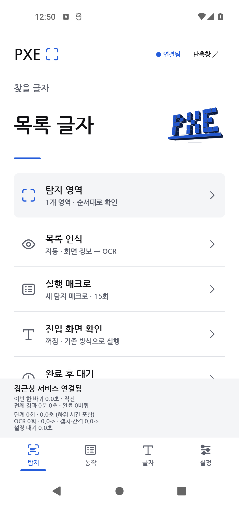
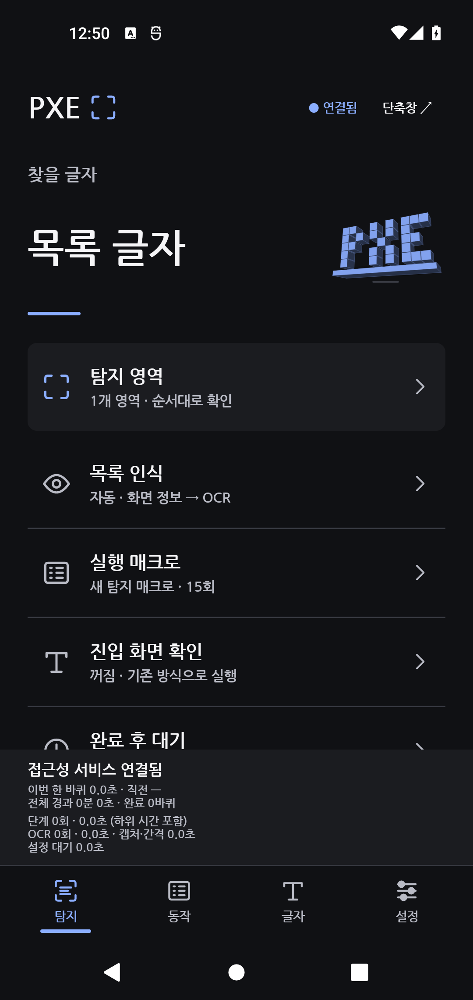
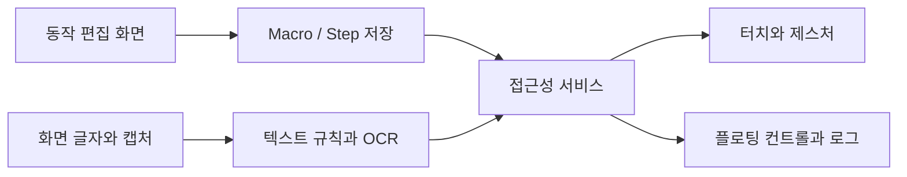

<a name="-pxe-project"></a>
# PXE Project

화면의 글자와 접근성 정보를 읽어 조건에 맞는 터치를 실행하는 Android 앱입니다.

<!-- project-levels:start -->
## 읽는 수준 선택

| 수준 · 이 안내에서 읽을 내용 |
| --- |
| **수준:** [LEVEL 1 - Beginner](docs/읽기안내/레벨1.md)<br>**이 안내에서 읽을 내용:** 낯선 용어를 풀어 쓰며 실제 동작·예시·오해하기 쉬운 범위를 읽습니다. |
| **수준:** [LEVEL 2 - Explorer](docs/읽기안내/레벨2.md)<br>**이 안내에서 읽을 내용:** 입력·처리·출력과 기능 사이의 연결, 차수 변화를 따라갑니다. |
| **수준:** [LEVEL 3 - Practitioner](docs/읽기안내/레벨3.md)<br>**이 안내에서 읽을 내용:** 준비 조건·사용 순서·설정·결과 및 실패 확인 방법을 읽습니다. |
| **수준:** [LEVEL 4 - Advanced](docs/읽기안내/레벨4.md)<br>**이 안내에서 읽을 내용:** 모듈 설계·상태 전이·검증 경계와 구현 선택을 검토합니다. |
| **수준:** [LEVEL 5 - Expert](docs/읽기안내/레벨5.md)<br>**이 안내에서 읽을 내용:** 실제 코드·프로토콜·설정값·전체 비교와 측정 근거를 대조합니다. |

모든 안내는 같은 프로젝트와 전체 차수를 다룹니다. 기존 상세 본문은 아래에 계속 보존합니다.
<!-- project-levels:end -->


**기술 분류:** Android 자동화 › 접근성·화면 인식 › OCR·조건 기반 터치 실행

`Android`
`Java`
`OCR`

[빠른 시작](#quick-start) · [저장소 구성](#repository-structure) · [동작 구성](#data-settings)

[핵심 구성](#input-processing-output)


## 최종 납품과 마지막 확인

공용 APK 한 개와 사용 안내를 로컬 최종 폴더에 저장하고 기존 차수 원본과 검증 이력을 보존합니다.

마지막 중앙 검사는 단위 255개, UTF-8, APK와 이전 차수 보존, 언어모델/계획 59개를 포함한 4개 검사 모두 통과했습니다. Java는 CPU 4, 최대 heap 512MiB로 관측됐습니다. 이 중앙 검사에는 합성 학습이 포함되지만 새 기기·Gradle·지연 주입 진단·24시간 시험은 실행하지 않았습니다.

화면 응답 시간 초과의 추가 원인 후보는 실제 재현·제품 수리를 완료하지 않았습니다. 기존의 실제 시범 학습 성공이나 중앙 통과가 그 오류의 해결을 보장하지 않습니다. [최종 납품 안내](최종/README.md) · [사용 안내](23차/사용안내.md)

<a name="-23차--선택형-오프라인-시범-학습"></a>
## 23차 · 선택형 오프라인 시범 학습

현재 선택형 모델은 시범 OCR 글자 특징을 사용하는 **584→32→K 구조의 F64 오프라인 MLP**입니다.

기존 매크로가 주 기능이며 AI는 기본 꺼짐입니다.

과거 한국어 자연어 Transformer 실험은 개발 평가11/64, 17.18%(소수 둘째 자리까지 버림; 원값17.1875%)로 실패했고 언어모델 자산은 앱에 포함하지 않았습니다(assets0). 현재 행동 MLP의 통과를 LLM 전체 완성으로 표시하지 않습니다.

전용 Android 시험의 관측 범위는 다음과 같습니다.

- 실행: 실제 시범 2회, 학습 192단계, OCR 관측 17회, 다른 UID 시험 앱의 자동 터치 1회와 FINISH 뒤 추가 입력 0을 확인했습니다.
- 가져오기와 추가 학습: 같은 설치의 별도 저장소와 새 작업 식별자로 가져온 뒤 추가 64단계를 학습했습니다.
- 원복: 30개 항목과 관리 대상 잔류 0을 확인했습니다. 실제 단일 기기 검사와 원복은 통과했고 별도 독립 대조도 통과했습니다.

[사용 안내](23차/사용안내.md) · [공용 APK](23차/공용APK_안내.md) · [기능·한계](docs/versions/23차.md) · [실제 검증 범위](23차/검증_결과.md) · [전체 차수·비교](docs/REVISION_INDEX.md)

다른 설치·휴대전화 간 이식, Android 파일 선택창(SAF)의 실제 조작, 모든 게임·사용자 작업·24시간 연속 운용은 검증하지 않았습니다. 중단된 장기 시험은 재개하지 않았습니다. 전체 실행207.468초에는 설치·증거·복원이 포함되므로 매크로 사이클 속도가 아닙니다.

<a name="implementation-details"></a>

<a name="-편집인식제스처저장-모듈"></a>
## 편집·인식·제스처·저장 모듈

제품 소스의 `MainActivity`는 매크로·글자·설정 편집을, `Macro`·`Step`은 JSON 모델과 입력 검증을, `MacroService`는 접근성 동작과 실행 상태를 맡습니다. 화면 위 컨트롤·글자 읽기·제스처 경로와 기기 검사는 해당 차수의 별도 클래스로 나뉩니다. UI에서 설정을 저장한 사실과 실제 대상 창에서 OCR·접근성 동작이 가능한지는 각각 확인합니다.

21차 Macro 기본값은 시작번호1·반복1·간격1000ms·시작대기3000ms·최대30분·adaptiveWait=false입니다. schema1 JSON의 동작은1~500개, 전체 반복0~100,000, 간격/시작 지연0~600,000ms, 최대시간0~1,440분을 검사합니다. 활성 동작마다 Step.validate를 호출합니다.

Step은 기본 TAP, 좌표50/50%, AUTO 인식·CONTAINS 비교·STOP 실패 정책, duration100ms·after500ms·repeat1·timeout3000ms·retries3·retryDelay1000ms입니다. 좌표0~100%와 유한값·검색영역 순서·오프셋±50%·정규식 문법·패키지명·분기번호를 검증합니다. 개별 반복1~1000, 재시도0~100, 재검색 지연300~600,000ms, occurrence1~100을 허용합니다. 글자 터치/대기에서만 계속 기다리기와 즉시 진행을 사용할 수 있습니다.

21차의 진입 확인은 기본 꺼짐이며 목록1~6순위→항목 진입→확인 글자 검사→매크로 실행으로 이어집니다. 되돌아갈 글자가 함께 보이면 그것을 우선하고, 유한 대기 동안 확인되지 않으면 뒤로 가서1순위부터 다시 찾습니다. 잘못 진입한 항목은 완료 수·완료 후 쉬는 시간에 넣지 않습니다. 일시정지는 현재 위치를 보존하고 글자를 바꾼 뒤 시작하면 새 설정으로 처음부터 실행합니다.

같은 앱 ID·서명으로 업데이트할 때의 데이터 유지와 새 빌드 서명 준비는 구분합니다. 예제 JSON·부분 검증 기록·화면 캡처 도구·20차 장시간 시험은 완전한 제품 소스와 자료 범위가 다릅니다. 특히 최종.json은7개 TEXT_TAP 설정이며 앱 버전이나 실행 성공 기록이 아닙니다.19차의120항목 기기검사·109항목/20클래스 단위검사·린트0 기록과20차 시험 기동은 각각 당시 범위의 관측입니다.

[각 차수의 코드·조건·관측·전체 비교](docs/REVISION_INDEX.md)


## 이전 21차 · 2.1.0 보관본

[21차 소스·빌드](21차/source/README.md) · [변경과 검사](docs/versions/21차.md) · [전체 차수](docs/REVISION_INDEX.md)

진입 화면의 확인 글자에 따라 실행하거나 뒤로 가고, 실행 중 새 글자로 시작할 수 있습니다. 일시정지·계속 실행을 표시하고 기존 배치의 흑백·파란 포인트색을 정돈했습니다.

개인 키·프로필·실행 원문·APK·캐시는 공개하지 않습니다. 전용 시험 결과를 실제 게임의 처리 시간·정확도·24시간 안정성 보증으로 확대하지 않습니다.

전용 Android 12 시험 환경에서 직접 캡처한 라이트·다크 화면입니다.

<p> </p>

기존 공개 서명 설정은 인증값을 제외한 안내로 바꾼 상태를 유지합니다. 과거 Git 이력은 남으며 해당 값의 현재 유효성은 미확인입니다. [19차 정리 기록](docs/versions/19차.md)을 보존합니다.

## ⏱️ 20차 · 19차 제품의 장시간 시험 도구

[시험 도구와 시작 안내](20차/공개용_변경기록.md) · [시험 구성과 관측 범위](docs/versions/20차.md) · [19→20 전체 비교](docs/revision-audit/20차.md)

기존 19차 APK로 실제 OCR·15회 반복·뒤로가기·중복 차단의 연속성을 관측하는 별도 시험 차수입니다. 2026-11-02 시작 자료를 보관하며 24시간 본시험은 사용자 요청으로 중단했습니다. [중단 안내](20차/시험_중단안내.md)를 추가했습니다. 당시 시작 기록을 보존하며 24시간 통과 결과로 표시하지 않습니다.

<a name="overview"></a>

<a name="latest-changes"></a>
<a name="-이전-14차의-변화와-차수-탐색"></a>
## 이전 14차의 변화와 차수 탐색

**14차 · 이전 보관본** — 청록 UI·터치 영역과 글자 재확인 분기

- 청록색 UI·48dp 터치 영역·시스템 모션 설정을 적용합니다. 정지·일시정지·대상 앱 경계는 UI 변경과 함께 확인해야 합니다.
- TEXT_TAP 재확인에서 글자가 사라지면 waitForever 상태의 원래 대기를 재개합니다. TEXT_NOT_FOUND 상세 오류 기록도 13차와 구별됩니다.

[14차 자료 자세히 보기](docs/versions/14%EC%B0%A8.md) · [전체 차수 의미 비교](docs/VERSIONS.md)

<a name="-차수-바로가기"></a>
### 차수 바로가기

[기본](docs/versions/%EA%B8%B0%EB%B3%B8.md) · [1차](docs/versions/1%EC%B0%A8.md) · [3차](docs/versions/3%EC%B0%A8.md) · [4차](docs/versions/4%EC%B0%A8.md) · [5차](docs/versions/5%EC%B0%A8.md) · [6차](docs/versions/6%EC%B0%A8.md) · [8차](docs/versions/8%EC%B0%A8.md) · [9차](docs/versions/9%EC%B0%A8.md) · [10차](docs/versions/10%EC%B0%A8.md) · [11차](docs/versions/11%EC%B0%A8.md) · [12차](docs/versions/12%EC%B0%A8.md) · [13차](docs/versions/13%EC%B0%A8.md) · [14차](docs/versions/14%EC%B0%A8.md) · [15차](15차/source/README.md) · [16차](16차/source/README.md) · [실행점검/2차](docs/versions/%EC%8B%A4%ED%96%89%EC%A0%90%EA%B2%80-2%EC%B0%A8.md)

코드/의 차수 밖 NEX 자료와 실행점검/2차는 별도로 안내합니다. 실행점검/2차는 제품 앱의 2차가 아닙니다.

| 관심 있는 내용 · 바로가기 |
| --- |
| **관심 있는 내용:** 코드를 먼저 보고 싶어요<br>**바로가기:** [최신 원본 폴더](23차/source/) |
| **관심 있는 내용:** 이전과 무엇이 다른가요?<br>**바로가기:** [차수별 해설과 근거](docs/VERSIONS.md) |
| **관심 있는 내용:** 어떻게 실행하나요?<br>**바로가기:** [준비 조건과 실행 제약](#quick-start) |


<a name="preview"></a>

<a name="input-processing-output"></a>

<a name="-입력처리출력"></a>
## 입력·처리·출력

**단계:** 입력

**이 프로젝트에서 다루는 내용:** 동작 목록·화면 글자·좌표

**단계:** 처리

**이 프로젝트에서 다루는 내용:** AccessibilityService·ML Kit OCR·글자 조건·제스처

**단계:** 출력

**이 프로젝트에서 다루는 내용:** 터치 실행·플로팅 상태·로그


---

<a name="introduction"></a>

<a name="-프로젝트-소개"></a>
## 프로젝트 소개

반복하는 터치와 화면 확인을 동작 목록으로 구성하는 안드로이드 프로젝트입니다.

PXE는 동작 목록을 편집·저장하고 접근성 서비스에서 실행합니다. 좌표 입력뿐 아니라 화면의 글자를 찾아 터치하거나 기다리고, 조건에 따라 다음 동작을 바꾸는 흐름을 구성합니다.

**기능:** 터치 동작

**구현 내용:** 단일·두 번·길게 누르기, 스와이프, 다중 터치

**기능:** 제스처

**구현 내용:** 곡선·확대·축소·녹화 경로

**기능:** 글자 조건

**구현 내용:** 글자 터치·대기·분기·확인

**기능:** 화면 인식

**구현 내용:** 접근성 노드와 ML Kit 한국어 OCR

**기능:** 실행 제어

**구현 내용:** 시작·정지·일시정지, 반복과 대기 시간

**기능:** 플로팅 화면

**구현 내용:** 실행 상태와 화면 영역 선택




<a name="repository-structure"></a>

<a name="-저장소-구성"></a>
## 저장소 구성

초기 코드와 여러 개발 단계의 주요 경로는 다음과 같습니다.

```text
.
├── 코드/
├── 1차/ … 15차/
├── 15차/source/
│   ├── 빌드.ps1
│   ├── app/src/main/java/kr/yunseok/touchmacro/
│   │   ├── MainActivity.java
│   │   ├── MacroService.java
│   │   ├── Macro.java
│   │   ├── Step.java
│   │   ├── FloatingController.java
│   │   ├── TextRules.java
│   │   └── WatchConfig.java
│   ├── app/src/androidTest/java/
│   └── tools/
└── docs/VERSIONS.md
```

- [15차 소스](15차/source/), [동작 모델](15차/source/app/src/main/java/kr/yunseok/touchmacro/Step.java).
- [접근성 실행 서비스](15차/source/app/src/main/java/kr/yunseok/touchmacro/MacroService.java).
- [기기 검사 코드](15차/source/app/src/androidTest/java/), [버전 기록](docs/VERSIONS.md).

<a name="implementation"></a>

<a name="-주요-기술과-실행-흐름"></a>
## 주요 기술과 실행 흐름

저장한 동작은 `MacroService`가 실행합니다. 이 서비스는 Android `AccessibilityService`를 확장하고 스크린샷과 OCR 요청의 상태를 관리합니다. 서비스가 연결 해제되거나 화면 방향이 바뀌는 경로에서 실행 상태를 정리합니다. `Step.validate()`는 좌표·시간·반복·분기 번호·텍스트 조건을 검사합니다.

접근성 권한은 실제 기기에서 사용자가 설정해야 합니다. 앱의 코드 존재만으로 다른 앱의 화면 제어 권한이 자동 부여되는 것은 아닙니다.

<a name="-저장인식-요청의-경계"></a>
### 저장·인식 요청의 경계

매크로는 SharedPreferences의 JSON으로 저장하며 불러오기 실패 시 예제로 돌아가는 경로가 있습니다. `SetupFlow`의 초안·백업 보존 기능과 별개로 모든 실패에서 무손실 복구를 보장하지는 않습니다.

`CaptureRequests`는 미완료 캡처를 최대 2개로 제한합니다. 15차의 `CapturePacer`는 실제 응답 뒤 API30에서 1.1초, API31 이상에서 0.5초를 기준으로 기다립니다. 간격 거절 시 최대 12초까지 늘리고 성공 뒤 기준까지 점진적으로 회복합니다. `QueryLane`은 화면 읽기 동시 요청을 막으며, `WatchGate`는 두 번 이상의 연속 부재와 최소 부재 시간을 만족해야 중복 진입 잠금을 풉니다.

`TextRules`는 NFKC·공백·소문자 정규화를 거친 일치·포함 비교와 정규식 검색을 제공합니다. 제스처 경로는 1~20개, 경로당 점은 1~512개로 검사합니다. 원본 14차 개발 구성은 Java 17·AGP 8.9.1·Gradle 8.13·Android SDK 35이며, 최소 Android API 30과 ML Kit 한국어 인식 16.0.1을 사용합니다.

<a name="️-차수별로-달라진-동작"></a>
### 차수별로 달라진 동작

**차수:** 1~3차

**주요 변화:** 초기 서비스 패널에서 별도 제어창으로 분리하고 제스처 녹화·곡선·다중 터치·영역과 위치 보정을 확장합니다.

**차수:** 4~5차

**주요 변화:** 새로고침→글자 탐지→선택 매크로→복귀 루프를 추가합니다. 5차의 탐지 반복 기본 15회는 저장 매크로의 전체 반복과 곱하지 않습니다.

**차수:** 6차

**주요 변화:** 최대 6개 우선 영역, 대상 앱·중복 잠금·완료 후 대기, 단계별 안내와 임시 녹화를 도입합니다.

**차수:** 8~9차

**주요 변화:** 별도 화면 읽기와 캡처 간격 조절을 추가합니다. 플로팅 재생은 저장된 탐지 설정을 실행하며 설정이 없으면 시작하지 않습니다.

**차수:** 10~11차

**주요 변화:** 네이티브 하단 탐색·카드 UI, 창 이벤트 기반 대상 앱 확인, AUTO 모드의 읽기 지연 시 OCR 전환을 추가합니다.

**차수:** 12~13차

**주요 변화:** 계속 기다리기, 늦은 응답 폐기, 접힌 패널의 정지 버튼, 캡처 최대 2개·OCR Task 최대 1개와 연결 종료 처리를 보강합니다.

**차수:** 14차

**주요 변화:** 청록색 UI·48dp 터치 영역·시스템 모션 설정을 적용하고, 글자 재확인에서 대상이 사라졌을 때 원래 대기를 재개하는 분기를 수정합니다.

**차수:** 15차

**주요 변화:** 목록·개별 인식 방식의 기본 노출과 범위 안내, 캡처 간격의 정상 회복, 활성 탐지 반복 대기 축소, 선택형 즉시 진입과 설정 접기를 적용합니다. 전체 OCR·중심점 필터와 기존 보호는 유지합니다.


위자드 기본값은 완료 후 새로고침 대기 켜짐(`waitForRefresh=true`), 중복 방지 꺼짐(`preventDuplicate=false`)입니다. 완료 후 대기와 글자 부재에 따른 중복 잠금 해제는 서로 다른 설정입니다.

<a name="-기록에-남는-정보"></a>
### 기록에 남는 정보

일반 실행 기록은 최근 150줄을 보관하며 인식한 본문과 탐지 문구가 들어갈 수 있습니다. 사용자가 저장하는 로그와 시험 도구의 화면·인식 결과를 외부에 공유할 때 이 내용을 확인해야 합니다. 별도 `ErrorJournal`은 128KiB 파일 두 개를 순환하며 오류 종류·상태를 기록합니다. 일반 로그에는 인식 본문이 남을 수 있어 공유 전에 개인정보를 확인해야 합니다.

<a name="quick-start"></a>

<a name="-빠른-시작"></a>
## 빠른 시작

최신23차는 제품 소스·Gradle 설정·Manifest·리소스·검사·기존 글꼴 라이선스를 포함합니다. JDK17·Android SDK35·Gradle8.13·Python을 준비한 뒤 [공용 빌드 안내](23차/source/빌드방법.txt)를 따릅니다.

```powershell
cd 23차/source
.\gradlew.bat :app:assembleRelease :app:testDebugUnitTest :app:lintDebug :app:assembleReleaseAndroidTest -PNEX_PC
```

`-PNEX_PC`는 ARM64와 x86_64를 함께 포함하는 공용 산출물을 선택합니다. 공개 빌드 스크립트는 실제 일반 작업 폴더와 사용자 환경 설정을 사용하며 연결을 생성하지 않습니다. 서명 키는 공개하지 않고 기존 앱 업데이트에는 같은 서명이 필요합니다. [사용 안내](23차/사용안내.md)를 참고하세요.

19차의 실제 로컬 검증과 한계는 변경 기록에 따로 적습니다. Android 소유 시험 장치의 결과를 사용자 블루스택이나 24시간 무중단 검증으로 표현하지 않습니다.

<a name="data-settings"></a>

<a name="-데이터와-동작-구성"></a>
## 데이터와 동작 구성

**항목:** 저장 스키마

**15차 코드의 구성:** `schema = 1`

**항목:** 동작 수

**15차 코드의 구성:** 1~500개

**항목:** 좌표

**15차 코드의 구성:** 화면 기준 0~100%

**항목:** 텍스트 비교

**15차 코드의 구성:** 포함·일치·정규식

**항목:** 텍스트 소스

**15차 코드의 구성:** AUTO·ACCESS·OCR

**항목:** 실패 동작

**15차 코드의 구성:** 정지·건너뛰기·뒤로 재시도·재시도·스크롤 재시도

**항목:** 시간·반복

**15차 코드의 구성:** 개별 동작과 전체 매크로 설정을 각각 검사


개별 동작의 계속 기다리기와 즉시 진행은 글자 터치·글자 대기에 적용됩니다. 15차 목록 설정의 인식 즉시 들어가기는 별도 선택입니다. UI 설명과 내부 직렬화 값을 바꿀 때는 저장된 매크로와의 호환성도 확인해야 합니다.

<a name="troubleshooting"></a>

<a name="️-문제-해결"></a>
## 문제 해결

**증상:** 실행 서비스가 연결되지 않음

**확인할 내용:** 실제 기기의 PXE 접근성 설정

**증상:** OCR이 응답하지 않음

**확인할 내용:** 캡처·인식 단계와 오류 기록, 기기 지원

**증상:** 좌표가 맞지 않음

**확인할 내용:** 화면 방향과 0~100% 좌표·검색 영역

**증상:** 동작 저장이 거부됨

**확인할 내용:** `Step.validate()`의 시간·좌표·분기 범위

**증상:** 빌드 입력 누락

**확인할 내용:** Gradle 설정·manifest·리소스·SDK·서명키

**증상:** 화면 위 컨트롤이 사라짐

**확인할 내용:** 서비스 연결과 창 토큰 상태


---

<div align="center">

**동작을 구성하고, 상태를 확인하며 실행합니다.**

</div>

<!-- apps-revision-audit -->
<a name="-모든-차수보관본과-전체-차이"></a>
## 모든 차수·보관본과 전체 차이

각 차수의 소스·설정·리소스·사용법·설계를 함께 보관합니다. 부분 자료와 실제 제품 버전을 각 설명에서 구분합니다.

| 차수·자료 · 자료 폴더·원본 · 상세 설명 · 직전 비교·범위 |
| --- |
| **차수·자료:** 기본<br>**자료 폴더·원본:** [자료 폴더](%EC%BD%94%EB%93%9C)<br>**상세 설명:** [상세 설명](docs/versions/%EA%B8%B0%EB%B3%B8.md)<br>**직전 비교·범위:** [전체 비교·범위](docs/revision-audit/%EA%B8%B0%EB%B3%B8.md) |
| **차수·자료:** 1차<br>**자료 폴더·원본:** [자료 폴더](1%EC%B0%A8)<br>**상세 설명:** [상세 설명](docs/versions/1%EC%B0%A8.md)<br>**직전 비교·범위:** [전체 비교·범위](docs/revision-audit/1%EC%B0%A8.md) |
| **차수·자료:** 2차<br>**자료 폴더·원본:** [자료 폴더](2%EC%B0%A8)<br>**상세 설명:** [상세 설명](docs/versions/2%EC%B0%A8.md)<br>**직전 비교·범위:** [전체 비교·범위](docs/revision-audit/2%EC%B0%A8.md) |
| **차수·자료:** 3차<br>**자료 폴더·원본:** [자료 폴더](3%EC%B0%A8)<br>**상세 설명:** [상세 설명](docs/versions/3%EC%B0%A8.md)<br>**직전 비교·범위:** [전체 비교·범위](docs/revision-audit/3%EC%B0%A8.md) |
| **차수·자료:** 4차<br>**자료 폴더·원본:** [자료 폴더](4%EC%B0%A8)<br>**상세 설명:** [상세 설명](docs/versions/4%EC%B0%A8.md)<br>**직전 비교·범위:** [전체 비교·범위](docs/revision-audit/4%EC%B0%A8.md) |
| **차수·자료:** 5차<br>**자료 폴더·원본:** [자료 폴더](5%EC%B0%A8)<br>**상세 설명:** [상세 설명](docs/versions/5%EC%B0%A8.md)<br>**직전 비교·범위:** [전체 비교·범위](docs/revision-audit/5%EC%B0%A8.md) |
| **차수·자료:** 6차<br>**자료 폴더·원본:** [자료 폴더](6%EC%B0%A8)<br>**상세 설명:** [상세 설명](docs/versions/6%EC%B0%A8.md)<br>**직전 비교·범위:** [전체 비교·범위](docs/revision-audit/6%EC%B0%A8.md) |
| **차수·자료:** 7차<br>**자료 폴더·원본:** [자료 폴더](7%EC%B0%A8)<br>**상세 설명:** [상세 설명](docs/revision-audit/7%EC%B0%A8.md)<br>**직전 비교·범위:** [전체 비교·범위](docs/revision-audit/7%EC%B0%A8.md) |
| **차수·자료:** 8차<br>**자료 폴더·원본:** [자료 폴더](8%EC%B0%A8)<br>**상세 설명:** [상세 설명](docs/versions/8%EC%B0%A8.md)<br>**직전 비교·범위:** [전체 비교·범위](docs/revision-audit/8%EC%B0%A8.md) |
| **차수·자료:** 9차<br>**자료 폴더·원본:** [자료 폴더](9%EC%B0%A8)<br>**상세 설명:** [상세 설명](docs/versions/9%EC%B0%A8.md)<br>**직전 비교·범위:** [전체 비교·범위](docs/revision-audit/9%EC%B0%A8.md) |
| **차수·자료:** 10차<br>**자료 폴더·원본:** [자료 폴더](10%EC%B0%A8)<br>**상세 설명:** [상세 설명](docs/versions/10%EC%B0%A8.md)<br>**직전 비교·범위:** [전체 비교·범위](docs/revision-audit/10%EC%B0%A8.md) |
| **차수·자료:** 11차<br>**자료 폴더·원본:** [자료 폴더](11%EC%B0%A8)<br>**상세 설명:** [상세 설명](docs/versions/11%EC%B0%A8.md)<br>**직전 비교·범위:** [전체 비교·범위](docs/revision-audit/11%EC%B0%A8.md) |
| **차수·자료:** 12차<br>**자료 폴더·원본:** [자료 폴더](12%EC%B0%A8)<br>**상세 설명:** [상세 설명](docs/versions/12%EC%B0%A8.md)<br>**직전 비교·범위:** [전체 비교·범위](docs/revision-audit/12%EC%B0%A8.md) |
| **차수·자료:** 13차<br>**자료 폴더·원본:** [자료 폴더](13%EC%B0%A8)<br>**상세 설명:** [상세 설명](docs/versions/13%EC%B0%A8.md)<br>**직전 비교·범위:** [전체 비교·범위](docs/revision-audit/13%EC%B0%A8.md) |
| **차수·자료:** 14차<br>**자료 폴더·원본:** [자료 폴더](14%EC%B0%A8)<br>**상세 설명:** [상세 설명](docs/versions/14%EC%B0%A8.md)<br>**직전 비교·범위:** [전체 비교·범위](docs/revision-audit/14%EC%B0%A8.md) |
| **차수·자료:** 15차<br>**자료 폴더·원본:** [자료 폴더](15%EC%B0%A8)<br>**상세 설명:** [상세 설명](docs/versions/15%EC%B0%A8.md)<br>**직전 비교·범위:** [전체 비교·범위](docs/revision-audit/15%EC%B0%A8.md) |
| **차수·자료:** 16차<br>**자료 폴더·원본:** [자료 폴더](16%EC%B0%A8)<br>**상세 설명:** [상세 설명](docs/versions/16%EC%B0%A8.md)<br>**직전 비교·범위:** [전체 비교·범위](docs/revision-audit/16%EC%B0%A8.md) |
| **차수·자료:** 17차<br>**자료 폴더·원본:** [자료 폴더](17%EC%B0%A8)<br>**상세 설명:** [상세 설명](docs/versions/17%EC%B0%A8.md)<br>**직전 비교·범위:** [전체 비교·범위](docs/revision-audit/17%EC%B0%A8.md) |
| **차수·자료:** 18차<br>**자료 폴더·원본:** [자료 폴더](18%EC%B0%A8)<br>**상세 설명:** [상세 설명](docs/versions/18%EC%B0%A8.md)<br>**직전 비교·범위:** [전체 비교·범위](docs/revision-audit/18%EC%B0%A8.md) |
| **차수·자료:** 19차<br>**자료 폴더·원본:** [자료 폴더](19%EC%B0%A8)<br>**상세 설명:** [상세 설명](docs/versions/19%EC%B0%A8.md)<br>**직전 비교·범위:** [전체 비교·범위](docs/revision-audit/19%EC%B0%A8.md) |
| **차수·자료:** 실행점검-2차<br>**자료 폴더·원본:** [자료 폴더](%EC%8B%A4%ED%96%89%EC%A0%90%EA%B2%80/2%EC%B0%A8)<br>**상세 설명:** [상세 설명](docs/versions/%EC%8B%A4%ED%96%89%EC%A0%90%EA%B2%80-2%EC%B0%A8.md)<br>**직전 비교·범위:** [전체 비교·범위](docs/revision-audit/%EC%8B%A4%ED%96%89%EC%A0%90%EA%B2%80-2%EC%B0%A8.md) |
| **차수·자료:** 최종.json<br>**자료 폴더·원본:** [자료 폴더](docs/materials/022-%EC%B5%9C%EC%A2%85%EC%84%A4%EC%A0%95) · [원본 파일](%EC%B5%9C%EC%A2%85.json)<br>**상세 설명:** [상세 설명](docs/materials/022-%EC%B5%9C%EC%A2%85%EC%84%A4%EC%A0%95/README.md)<br>**직전 비교·범위:** [전체 비교·범위](docs/versions/%EC%B5%9C%EC%A2%85%EC%84%A4%EC%A0%95.md) |
| **차수·자료:** 고유 작업 자료<br>**자료 폴더·원본:** [자료 폴더](%EB%B3%B4%EC%A1%B4%EC%9E%90%EB%A3%8C/%EC%9E%91%EC%97%85%EC%86%8C%EC%8A%A4)<br>**상세 설명:** [상세 설명](docs/SOURCE_MATERIALS.md)<br>**직전 비교·범위:** [전체 비교·범위](docs/REVISION_AUDIT.md) |
| **차수·자료:** 20차 · 시험 도구<br>**자료 폴더·원본:** [자료 폴더](20%EC%B0%A8)<br>**상세 설명:** [상세 설명](docs/versions/20%EC%B0%A8.md)<br>**직전 비교·범위:** [전체 비교·범위](docs/revision-audit/20%EC%B0%A8.md) |
| **차수·자료:** 21차<br>**자료 폴더·원본:** [자료 폴더](21%EC%B0%A8)<br>**상세 설명:** [상세 설명](docs/versions/21%EC%B0%A8.md)<br>**직전 비교·범위:** [전체 비교·범위](docs/revision-audit/21%EC%B0%A8.md) |
| **차수·자료:** 22차<br>**자료 폴더·원본:** [자료 폴더](22차)<br>**상세 설명:** [상세 설명](docs/versions/22차.md)<br>**직전 비교·범위:** [전체 비교·범위](docs/revision-audit/22차.md) |
| **차수·자료:** 23차<br>**자료 폴더·원본:** [자료 폴더](23차)<br>**상세 설명:** [상세 설명](docs/versions/23차.md)<br>**직전 비교·범위:** [전체 비교·범위](docs/revision-audit/23차.md) |
| **차수·자료:** 최종<br>**자료 폴더·원본:** [자료 폴더](최종)<br>**상세 설명:** [상세 설명](최종/README.md)<br>**직전 비교·범위:** [전체 비교·범위](docs/revision-audit/최종.md) |


<a name="️-차수별-화면과-검증-이미지"></a>
### 차수별 화면과 검증 이미지

[원문 이미지·차수별 출처·파일 해시](docs/IMAGE_MATERIALS.md)에서 화면과 합성 테스트 입력을 확인할 수 있습니다.
