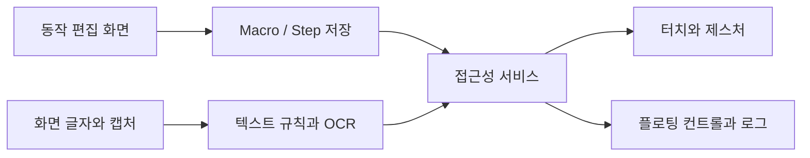

<div align="center">

# 👆 PXE 안드로이드 터치 매크로

### 동작 편집 · 화면 글자 인식 · 플로팅 실행 컨트롤

터치·제스처·글자 조건을 순서대로 구성해 반복 작업을 실행합니다.<br>
접근성 서비스와 한국어 OCR, 화면 위 컨트롤을 연결한 Android Java 앱입니다.


[빠른 시작](#quick-start) · [저장소 구성](#repository-structure) · [동작 구성](#data-settings)

</div>

---

<a name="introduction"></a>

## ✨ 프로젝트 소개

PXE는 동작 목록을 편집·저장하고 접근성 서비스에서 실행합니다. 좌표 입력뿐 아니라 화면의 글자를 찾아 터치하거나 기다리고, 조건에 따라 다음 동작을 바꾸는 흐름을 구성합니다.

| 기능 | 구현 내용 |
| :--- | :--- |
| 터치 동작 | 단일·두 번·길게 누르기, 스와이프, 다중 터치 |
| 제스처 | 곡선·확대·축소·녹화 경로 |
| 글자 조건 | 글자 터치·대기·분기·확인 |
| 화면 인식 | 접근성 노드와 ML Kit 한국어 OCR |
| 실행 제어 | 시작·정지·일시정지, 반복과 대기 시간 |
| 플로팅 화면 | 실행 상태와 화면 영역 선택 |



<a name="repository-structure"></a>

## 📁 저장소 구성

주요 경로를 발췌했습니다. 초기 코드와 여러 차수의 구현을 함께 보존합니다.

```text
.
├── 코드/
├── 1차/ … 14차/
├── 14차/source/
│   ├── 빌드.ps1
│   ├── app/src/main/java/kr/yunseok/touchmacro/
│   │   ├── MainActivity.java
│   │   ├── MacroService.java
│   │   ├── Macro.java
│   │   ├── Step.java
│   │   ├── FloatingController.java
│   │   ├── TextRules.java
│   │   └── WatchConfig.java
│   ├── app/src/androidTest/java/
│   └── tools/
└── docs/VERSIONS.md
```

- [14차 소스](14차/source/), [동작 모델](14차/source/app/src/main/java/kr/yunseok/touchmacro/Step.java).
- [접근성 실행 서비스](14차/source/app/src/main/java/kr/yunseok/touchmacro/MacroService.java).
- [기기 검사 코드](14차/source/app/src/androidTest/java/), [버전 기록](docs/VERSIONS.md).

<a name="implementation"></a>

## 🧩 주요 기술과 실행 흐름

`MacroService`는 Android `AccessibilityService`를 확장하고, 스크린샷 요청과 OCR 요청의 상태를 관리합니다. 서비스가 연결 해제되거나 화면 방향이 바뀌는 경로에서 실행 상태를 정리합니다. `Step.validate()`는 좌표·시간·반복·분기 번호·텍스트 조건을 검사합니다.

접근성 권한은 실제 기기에서 사용자가 설정해야 합니다. 앱의 코드 존재만으로 다른 앱의 화면 제어 권한이 자동 부여되는 것은 아닙니다.

### 저장·인식 요청의 경계

매크로는 SharedPreferences의 JSON으로 저장하며 불러오기 실패 시 예제로 돌아가는 경로가 있습니다. `SetupFlow`의 초안·백업 보존 기능과 별개로 모든 실패에서 무손실 복구를 보장하지는 않습니다.

`CaptureRequests`는 미완료 캡처를 최대 2개로 제한합니다. `CapturePacer`는 응답 뒤 기본 2초를 기다리고 거절 시 최대 12초까지 대기 간격을 늘립니다. `QueryLane`은 화면 읽기 동시 요청을 막으며, `WatchGate`는 두 번 이상의 연속 부재와 최소 부재 시간을 만족해야 중복 진입 잠금을 풉니다.

`TextRules`는 NFKC·공백·소문자 정규화를 거친 일치·포함 비교와 정규식 검색을 제공합니다. 제스처 경로는 1~20개, 경로당 점은 1~512개로 검사합니다. 14차 빌드는 JDK 17·Gradle 8.13·개인 서명키와 기존 로컬 경로를 요구합니다.

<a name="quick-start"></a>

## 🚀 빠른 시작

현재 공개 사본은 Java 구현·검사·보조 스크립트를 중심으로 구성되어 있습니다. Gradle 빌드 설정, Android manifest·리소스, 개인 서명키와 전체 SDK 구성이 모두 들어 있는 완성 빌드 패키지는 아닙니다.

1. `14차/source`의 구현과 동작 모델을 먼저 살펴봅니다.
2. 실행 프로젝트를 준비할 때 Android 프로젝트 설정·리소스·ML Kit 의존성을 원래 구성과 맞춥니다.
3. 완전한 개발 환경에서 접근성 연결·텍스트 인식·중지 동작을 기기에서 확인합니다.

기존 빌드 스크립트가 사용하는 Gradle 작업은 다음과 같습니다. 완전한 프로젝트 루트와 해당 Gradle 설치를 준비한 뒤 사용하는 명령입니다.

```powershell
gradle :app:assembleRelease :app:testDebugUnitTest :app:lintDebug --console=plain --no-watch-fs
```

`빌드.ps1`은 원래 D 드라이브 경로, 전용 junction, JDK·SDK·개인 서명키를 검사합니다. 공개 사본에서 이 스크립트를 그대로 실행하는 것으로 환경 준비가 끝나지는 않습니다.

<a name="data-settings"></a>

## 📊 데이터와 동작 구성

| 항목 | 14차 코드의 구성 |
| :--- | :--- |
| 저장 스키마 | `schema = 1` |
| 동작 수 | 1~500개 |
| 좌표 | 화면 기준 0~100% |
| 텍스트 비교 | 포함·일치·정규식 |
| 텍스트 소스 | AUTO·ACCESS·OCR |
| 실패 동작 | 정지·건너뛰기·뒤로 재시도·재시도·스크롤 재시도 |
| 시간·반복 | 개별 동작과 전체 매크로 설정을 각각 검사 |

계속 기다리기와 즉시 진행 옵션은 글자 터치·글자 대기 동작에 한정됩니다. UI 설명과 내부 직렬화 값을 바꿀 때는 저장된 매크로와의 호환성도 확인해야 합니다.

<a name="troubleshooting"></a>

## 🛠️ 문제 해결

| 증상 | 확인할 내용 |
| :--- | :--- |
| 실행 서비스가 연결되지 않음 | 실제 기기의 PXE 접근성 설정 |
| OCR이 응답하지 않음 | 캡처·인식 단계와 오류 기록, 기기 지원 |
| 좌표가 맞지 않음 | 화면 방향과 0~100% 좌표·검색 영역 |
| 동작 저장이 거부됨 | `Step.validate()`의 시간·좌표·분기 범위 |
| 빌드 입력 누락 | Gradle 설정·manifest·리소스·SDK·서명키 |
| 화면 위 컨트롤이 사라짐 | 서비스 연결과 창 토큰 상태 |

---

<div align="center">

**동작을 구성하고, 상태를 확인하며 실행합니다.**

</div>
