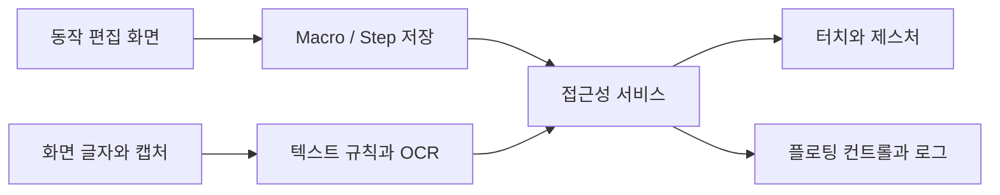

# PXE Project · LEVEL 2 - Explorer

[LEVEL 1 - Beginner](%EB%A0%88%EB%B2%A81.md) · [LEVEL 2 - Explorer](%EB%A0%88%EB%B2%A82.md) · [LEVEL 3 - Practitioner](%EB%A0%88%EB%B2%A83.md) · [LEVEL 4 - Advanced](%EB%A0%88%EB%B2%A84.md) · [LEVEL 5 - Expert](%EB%A0%88%EB%B2%A85.md)

[같은 수준의 프로필](https://github.com/PUVKID/PUVKID/blob/main/docs/읽기안내/레벨2.md) · [프로젝트 첫 화면](../../README.md)

## LEVEL 2 · 프로젝트 소개와 읽는 방법

매크로 편집→화면 읽기→조건 비교→접근성 동작→대기·분기→진행 상태의 흐름입니다. 목록 탐지와 개별 글자 동작,진입 확인과 실제 매크로 실행을 나누어 읽습니다.

## LEVEL 2 · 실제 기능과 동작 범위

접근성 텍스트와 OCR은 입력 출처가 다릅니다. 확인 글자·되돌아갈 글자·현재 화면·대상 앱에 따라 실행 분기가 달라지고 일시정지와 새 설정 시작의 상태도 다릅니다.

기능 사이에서 자료와 상태가 어떻게 이어지는지 함께 읽습니다.

**기능별 공통 근거**

반복하는 터치와 화면 확인을 동작 목록으로 구성하는 안드로이드 프로젝트입니다.

PXE는 동작 목록을 편집·저장하고 접근성 서비스에서 실행합니다. 좌표 입력뿐 아니라 화면의 글자를 찾아 터치하거나 기다리고, 조건에 따라 다음 동작을 바꾸는 흐름을 구성합니다.

**기능:** 터치 동작

**구현 내용:** 단일·두 번·길게 누르기, 스와이프, 다중 터치

**기능:** 제스처

**구현 내용:** 곡선·확대·축소·녹화 경로

**기능:** 글자 조건

**구현 내용:** 글자 터치·대기·분기·확인

**기능:** 화면 인식

**구현 내용:** 접근성 노드와 ML Kit 한국어 OCR

**기능:** 실행 제어

**구현 내용:** 시작·정지·일시정지, 반복과 대기 시간

**기능:** 플로팅 화면

**구현 내용:** 실행 상태와 화면 영역 선택




## LEVEL 2 · 입력에서 처리와 출력까지

화면 글자 출처→검색 영역·비교 방식→분기·재시도→제스처의 연결입니다. 전체 목록 탐지 설정과 개별 Step 인식 설정을 구분합니다.

**단계:** 입력

**이 프로젝트에서 다루는 내용:** 동작 목록·화면 글자·좌표

**단계:** 처리

**이 프로젝트에서 다루는 내용:** AccessibilityService·ML Kit OCR·글자 조건·제스처

**단계:** 출력

**이 프로젝트에서 다루는 내용:** 터치 실행·플로팅 상태·로그


---

## LEVEL 2 · 사용·실험 순서와 확인 방법

목록 탐지→항목 진입→확인 글자→매크로 실행 또는 뒤로가기→다시1순위 탐색으로 봅니다. 계속 대기·즉시 진행은 허용되는 글자 동작에서만 사용합니다.

## LEVEL 2 · 결과와 한계를 해석하는 기준

전용 단일 환경에서 실제 시범2회·학습192단계·OCR17회·자동터치1회·FINISH 뒤 추가입력0을 확인했습니다. 같은 설치의 별도 저장소 가져오기와 추가64단계·원복30항목·잔류0은 휴대전화 간 이식 검증과 다릅니다.

## LEVEL 2 · 구현과 핵심 파일을 연결해 읽기

화면 읽기·제스처·제어창·저장·기록·시범 정책은 별도 구성 요소입니다. 버전별로 바뀐 동작과 예제 JSON·캡처 도구·장기시험 자료를 구분합니다.

## LEVEL 2 · 용어와 실수하기 쉬운 구분

매크로는 사용자가 정한 동작 순서를 반복하는 기능입니다. 접근성 서비스는 앱이 허용한 화면 글자와 동작 정보를 읽고 터치를 실행하는 Android 기능입니다. OCR은 화면 이미지에서 글자를 읽는 방식이고 AUTO는 조건에 따라 읽기 방식을 고르는 설정입니다. 플로팅 제어창은 다른 앱 위에 보이는 작은 창입니다. 시범 학습은 사용자가 직접 보여 준 작업을 배우는 별도 선택 기능이며 범용 언어모델과 다릅니다.

**매크로가 주 기능이고 AI는 기본 꺼짐입니다.** 접근성·화면 읽기는 실제 기기에서 사용자가 허용해야 하며 캡처 제한을 우회하거나 읽지 못한 화면을 추측 터치하지 않습니다. 단일 기기 시험과 모든 게임·다른 설치·24시간 안정성은 다른 검증 범위입니다.

## LEVEL 2 · 전체 차수와 같은 수준의 상세 설명

차수 이름은 실제 보관 단위를 따릅니다. 부분본·시험 도구·최종 안내는 제품 버전과 구분하며, 폴더와 직전 비교를 함께 연결합니다.

| 내용 |
| --- |
| **차수·자료:** 기본<br>**자료 폴더:** [자료](../../%EC%BD%94%EB%93%9C)<br>**이 수준의 차수 설명:** [LEVEL 2 - Explorer](../versions/%EA%B8%B0%EB%B3%B8.md#reading-level-2)<br>**직전 비교·범위:** [전체 비교](../revision-audit/%EA%B8%B0%EB%B3%B8.md) |
| **차수·자료:** 1차<br>**자료 폴더:** [자료](../../1%EC%B0%A8)<br>**이 수준의 차수 설명:** [LEVEL 2 - Explorer](../versions/1%EC%B0%A8.md#reading-level-2)<br>**직전 비교·범위:** [전체 비교](../revision-audit/1%EC%B0%A8.md) |
| **차수·자료:** 2차<br>**자료 폴더:** [자료](../../2%EC%B0%A8)<br>**이 수준의 차수 설명:** [LEVEL 2 - Explorer](../versions/2%EC%B0%A8.md#reading-level-2)<br>**직전 비교·범위:** [전체 비교](../revision-audit/2%EC%B0%A8.md) |
| **차수·자료:** 3차<br>**자료 폴더:** [자료](../../3%EC%B0%A8)<br>**이 수준의 차수 설명:** [LEVEL 2 - Explorer](../versions/3%EC%B0%A8.md#reading-level-2)<br>**직전 비교·범위:** [전체 비교](../revision-audit/3%EC%B0%A8.md) |
| **차수·자료:** 4차<br>**자료 폴더:** [자료](../../4%EC%B0%A8)<br>**이 수준의 차수 설명:** [LEVEL 2 - Explorer](../versions/4%EC%B0%A8.md#reading-level-2)<br>**직전 비교·범위:** [전체 비교](../revision-audit/4%EC%B0%A8.md) |
| **차수·자료:** 5차<br>**자료 폴더:** [자료](../../5%EC%B0%A8)<br>**이 수준의 차수 설명:** [LEVEL 2 - Explorer](../versions/5%EC%B0%A8.md#reading-level-2)<br>**직전 비교·범위:** [전체 비교](../revision-audit/5%EC%B0%A8.md) |
| **차수·자료:** 6차<br>**자료 폴더:** [자료](../../6%EC%B0%A8)<br>**이 수준의 차수 설명:** [LEVEL 2 - Explorer](../versions/6%EC%B0%A8.md#reading-level-2)<br>**직전 비교·범위:** [전체 비교](../revision-audit/6%EC%B0%A8.md) |
| **차수·자료:** 7차<br>**자료 폴더:** [자료](../../7%EC%B0%A8)<br>**이 수준의 차수 설명:** [LEVEL 2 - Explorer](../revision-audit/7%EC%B0%A8.md#reading-level-2)<br>**직전 비교·범위:** [전체 비교](../revision-audit/7%EC%B0%A8.md) |
| **차수·자료:** 8차<br>**자료 폴더:** [자료](../../8%EC%B0%A8)<br>**이 수준의 차수 설명:** [LEVEL 2 - Explorer](../versions/8%EC%B0%A8.md#reading-level-2)<br>**직전 비교·범위:** [전체 비교](../revision-audit/8%EC%B0%A8.md) |
| **차수·자료:** 9차<br>**자료 폴더:** [자료](../../9%EC%B0%A8)<br>**이 수준의 차수 설명:** [LEVEL 2 - Explorer](../versions/9%EC%B0%A8.md#reading-level-2)<br>**직전 비교·범위:** [전체 비교](../revision-audit/9%EC%B0%A8.md) |
| **차수·자료:** 10차<br>**자료 폴더:** [자료](../../10%EC%B0%A8)<br>**이 수준의 차수 설명:** [LEVEL 2 - Explorer](../versions/10%EC%B0%A8.md#reading-level-2)<br>**직전 비교·범위:** [전체 비교](../revision-audit/10%EC%B0%A8.md) |
| **차수·자료:** 11차<br>**자료 폴더:** [자료](../../11%EC%B0%A8)<br>**이 수준의 차수 설명:** [LEVEL 2 - Explorer](../versions/11%EC%B0%A8.md#reading-level-2)<br>**직전 비교·범위:** [전체 비교](../revision-audit/11%EC%B0%A8.md) |
| **차수·자료:** 12차<br>**자료 폴더:** [자료](../../12%EC%B0%A8)<br>**이 수준의 차수 설명:** [LEVEL 2 - Explorer](../versions/12%EC%B0%A8.md#reading-level-2)<br>**직전 비교·범위:** [전체 비교](../revision-audit/12%EC%B0%A8.md) |
| **차수·자료:** 13차<br>**자료 폴더:** [자료](../../13%EC%B0%A8)<br>**이 수준의 차수 설명:** [LEVEL 2 - Explorer](../versions/13%EC%B0%A8.md#reading-level-2)<br>**직전 비교·범위:** [전체 비교](../revision-audit/13%EC%B0%A8.md) |
| **차수·자료:** 14차<br>**자료 폴더:** [자료](../../14%EC%B0%A8)<br>**이 수준의 차수 설명:** [LEVEL 2 - Explorer](../versions/14%EC%B0%A8.md#reading-level-2)<br>**직전 비교·범위:** [전체 비교](../revision-audit/14%EC%B0%A8.md) |
| **차수·자료:** 15차<br>**자료 폴더:** [자료](../../15%EC%B0%A8)<br>**이 수준의 차수 설명:** [LEVEL 2 - Explorer](../versions/15%EC%B0%A8.md#reading-level-2)<br>**직전 비교·범위:** [전체 비교](../revision-audit/15%EC%B0%A8.md) |
| **차수·자료:** 16차<br>**자료 폴더:** [자료](../../16%EC%B0%A8)<br>**이 수준의 차수 설명:** [LEVEL 2 - Explorer](../versions/16%EC%B0%A8.md#reading-level-2)<br>**직전 비교·범위:** [전체 비교](../revision-audit/16%EC%B0%A8.md) |
| **차수·자료:** 17차<br>**자료 폴더:** [자료](../../17%EC%B0%A8)<br>**이 수준의 차수 설명:** [LEVEL 2 - Explorer](../versions/17%EC%B0%A8.md#reading-level-2)<br>**직전 비교·범위:** [전체 비교](../revision-audit/17%EC%B0%A8.md) |
| **차수·자료:** 18차<br>**자료 폴더:** [자료](../../18%EC%B0%A8)<br>**이 수준의 차수 설명:** [LEVEL 2 - Explorer](../versions/18%EC%B0%A8.md#reading-level-2)<br>**직전 비교·범위:** [전체 비교](../revision-audit/18%EC%B0%A8.md) |
| **차수·자료:** 19차<br>**자료 폴더:** [자료](../../19%EC%B0%A8)<br>**이 수준의 차수 설명:** [LEVEL 2 - Explorer](../versions/19%EC%B0%A8.md#reading-level-2)<br>**직전 비교·범위:** [전체 비교](../revision-audit/19%EC%B0%A8.md) |
| **차수·자료:** 실행점검-2차<br>**자료 폴더:** [자료](../../%EC%8B%A4%ED%96%89%EC%A0%90%EA%B2%80/2%EC%B0%A8)<br>**이 수준의 차수 설명:** [LEVEL 2 - Explorer](../versions/%EC%8B%A4%ED%96%89%EC%A0%90%EA%B2%80-2%EC%B0%A8.md#reading-level-2)<br>**직전 비교·범위:** [전체 비교](../revision-audit/%EC%8B%A4%ED%96%89%EC%A0%90%EA%B2%80-2%EC%B0%A8.md) |
| **차수·자료:** 최종.json<br>**자료 폴더:** [자료](../materials/022-%EC%B5%9C%EC%A2%85%EC%84%A4%EC%A0%95)<br>**이 수준의 차수 설명:** [LEVEL 2 - Explorer](../materials/022-%EC%B5%9C%EC%A2%85%EC%84%A4%EC%A0%95/README.md#reading-level-2)<br>**직전 비교·범위:** [전체 비교](../versions/%EC%B5%9C%EC%A2%85%EC%84%A4%EC%A0%95.md) |
| **차수·자료:** 고유 작업 자료<br>**자료 폴더:** [자료](../../%EB%B3%B4%EC%A1%B4%EC%9E%90%EB%A3%8C/%EC%9E%91%EC%97%85%EC%86%8C%EC%8A%A4)<br>**이 수준의 차수 설명:** [LEVEL 2 - Explorer](../SOURCE_MATERIALS.md#reading-level-2)<br>**직전 비교·범위:** [전체 비교](../REVISION_AUDIT.md) |
| **차수·자료:** 20차 · 시험 도구<br>**자료 폴더:** [자료](../../20%EC%B0%A8)<br>**이 수준의 차수 설명:** [LEVEL 2 - Explorer](../versions/20%EC%B0%A8.md#reading-level-2)<br>**직전 비교·범위:** [전체 비교](../revision-audit/20%EC%B0%A8.md) |
| **차수·자료:** 21차<br>**자료 폴더:** [자료](../../21%EC%B0%A8)<br>**이 수준의 차수 설명:** [LEVEL 2 - Explorer](../versions/21%EC%B0%A8.md#reading-level-2)<br>**직전 비교·범위:** [전체 비교](../revision-audit/21%EC%B0%A8.md) |
| **차수·자료:** 22차<br>**자료 폴더:** [자료](../../22%EC%B0%A8)<br>**이 수준의 차수 설명:** [LEVEL 2 - Explorer](../versions/22%EC%B0%A8.md#reading-level-2)<br>**직전 비교·범위:** [전체 비교](../revision-audit/22%EC%B0%A8.md) |
| **차수·자료:** 23차<br>**자료 폴더:** [자료](../../23%EC%B0%A8)<br>**이 수준의 차수 설명:** [LEVEL 2 - Explorer](../versions/23%EC%B0%A8.md#reading-level-2)<br>**직전 비교·범위:** [전체 비교](../revision-audit/23%EC%B0%A8.md) |
| **차수·자료:** 최종<br>**자료 폴더:** [자료](../../%EC%B5%9C%EC%A2%85)<br>**이 수준의 차수 설명:** [LEVEL 2 - Explorer](../../%EC%B5%9C%EC%A2%85/README.md#reading-level-2)<br>**직전 비교·범위:** [전체 비교](../revision-audit/%EC%B5%9C%EC%A2%85.md) |

## LEVEL 2 · 논문·원고와 원본 자료의 범위

앱 소스·설정 예제·사용 안내·공용APK 안내·전용 시험·중단 기록의 실제 범위를 연결합니다. 언어모델 실패 실험을 현재 행동 MLP의 성공으로 바꾸지 않으며 논문이나 범용 AI 완성 성과를 만들지 않습니다. 개인 키·프로필·실행 원문·개인 작업 파일은 공개하지 않습니다.

## LEVEL 2 · 원래 모든 세부 설명으로 이동하기

설정값·코드 예제·실패 조건·측정 범위·화면과 파일별 안내를 생략하지 않도록 첫 화면의 전체 본문을 아래에 함께 둡니다. 각 항목은 이 페이지의 공통 근거로 바로 이동합니다. 원문에 담긴 이전 차수 조건을 현재 실행 조건으로 자동 적용하지 않습니다.

| 내용 |
| --- |
| **첫 화면의 원래 항목:** PXE Project<br>**이 페이지의 전체 근거:** [원문 보기](#source-section-1) |
| **첫 화면의 원래 항목:** 최종 납품과 마지막 확인<br>**이 페이지의 전체 근거:** [원문 보기](#source-section-2) |
| **첫 화면의 원래 항목:** 23차 · 선택형 오프라인 시범 학습<br>**이 페이지의 전체 근거:** [원문 보기](#source-section-3) |
| **첫 화면의 원래 항목:** 편집·인식·제스처·저장 모듈<br>**이 페이지의 전체 근거:** [원문 보기](#source-section-4) |
| **첫 화면의 원래 항목:** 이전 21차 · 2.1.0 보관본<br>**이 페이지의 전체 근거:** [원문 보기](#source-section-5) |
| **첫 화면의 원래 항목:** ⏱️ 20차 · 19차 제품의 장시간 시험 도구<br>**이 페이지의 전체 근거:** [원문 보기](#source-section-6) |
| **첫 화면의 원래 항목:** 이전 14차의 변화와 차수 탐색<br>**이 페이지의 전체 근거:** [원문 보기](#source-section-7) |
| **첫 화면의 원래 항목:** 차수 바로가기<br>**이 페이지의 전체 근거:** [원문 보기](#source-section-8) |
| **첫 화면의 원래 항목:** 입력·처리·출력<br>**이 페이지의 전체 근거:** [원문 보기](#source-section-9) |
| **첫 화면의 원래 항목:** 프로젝트 소개<br>**이 페이지의 전체 근거:** [원문 보기](#source-section-10) |
| **첫 화면의 원래 항목:** 저장소 구성<br>**이 페이지의 전체 근거:** [원문 보기](#source-section-11) |
| **첫 화면의 원래 항목:** 주요 기술과 실행 흐름<br>**이 페이지의 전체 근거:** [원문 보기](#source-section-12) |
| **첫 화면의 원래 항목:** 저장·인식 요청의 경계<br>**이 페이지의 전체 근거:** [원문 보기](#source-section-13) |
| **첫 화면의 원래 항목:** 차수별로 달라진 동작<br>**이 페이지의 전체 근거:** [원문 보기](#source-section-14) |
| **첫 화면의 원래 항목:** 기록에 남는 정보<br>**이 페이지의 전체 근거:** [원문 보기](#source-section-15) |
| **첫 화면의 원래 항목:** 빠른 시작<br>**이 페이지의 전체 근거:** [원문 보기](#source-section-16) |
| **첫 화면의 원래 항목:** 데이터와 동작 구성<br>**이 페이지의 전체 근거:** [원문 보기](#source-section-17) |
| **첫 화면의 원래 항목:** 문제 해결<br>**이 페이지의 전체 근거:** [원문 보기](#source-section-18) |
| **첫 화면의 원래 항목:** 모든 차수·보관본과 전체 차이<br>**이 페이지의 전체 근거:** [원문 보기](#source-section-19) |
| **첫 화면의 원래 항목:** 차수별 화면과 검증 이미지<br>**이 페이지의 전체 근거:** [원문 보기](#source-section-20) |

## LEVEL 2 · 항목별 자세한 풀이와 확인 지점

### LEVEL 2 · 최종 납품과 마지막 확인

이 항목의 설정과 자료 흐름은 다음 조건으로 연결됩니다. 같은 이름이 있어도 서로 다른 차수의 구성과 합치지 않습니다.

공용 APK 한 개와 사용 안내를 로컬 최종 폴더에 저장하고 기존 차수 원본과 검증 이력을 보존합니다.

마지막 중앙 검사는 단위 255개, UTF-8, APK와 이전 차수 보존, 언어모델/계획 59개를 포함한 4개 검사 모두 통과했습니다. Java는 CPU 4, 최대 heap 512MiB로 관측됐습니다. 이 중앙 검사에는 합성 학습이 포함되지만 새 기기·Gradle·지연 주입 진단·24시간 시험은 실행하지 않았습니다.

화면 응답 시간 초과의 추가 원인 후보는 실제 재현·제품 수리를 완료하지 않았습니다. 기존의 실제 시범 학습 성공이나 중앙 통과가 그 오류의 해결을 보장하지 않습니다. [최종 납품 안내](../../%EC%B5%9C%EC%A2%85/README.md#reading-level-2) · [사용 안내](../../23%EC%B0%A8/%EC%82%AC%EC%9A%A9%EC%95%88%EB%82%B4.md)

공용APK와 안내를 모으고 이전차수와 검증을 보존한 최종 구성입니다.

**흐름과 개념:** 실제 중앙4검사·단위255·UTF8·APK보존·언어모델59와 미실행 범위를 확인합니다. 새기기·Gradle·지연주입·24시간과 응답시간초과 제품수리 완료를 별도로 구분합니다.

**이 항목에서 연결되는 실제 설명**

공용 APK 한 개와 사용 안내를 로컬 최종 폴더에 저장하고 기존 차수 원본과 검증 이력을 보존합니다.

마지막 중앙 검사는 단위 255개, UTF-8, APK와 이전 차수 보존, 언어모델/계획 59개를 포함한 4개 검사 모두 통과했습니다. Java는 CPU 4, 최대 heap 512MiB로 관측됐습니다. 이 중앙 검사에는 합성 학습이 포함되지만 새 기기·Gradle·지연 주입 진단·24시간 시험은 실행하지 않았습니다.

화면 응답 시간 초과의 추가 원인 후보는 실제 재현·제품 수리를 완료하지 않았습니다. 기존의 실제 시범 학습 성공이나 중앙 통과가 그 오류의 해결을 보장하지 않습니다. [최종 납품 안내](../../%EC%B5%9C%EC%A2%85/README.md#reading-level-2) · [사용 안내](../../23%EC%B0%A8/%EC%82%AC%EC%9A%A9%EC%95%88%EB%82%B4.md)

[이 항목의 전체 조건·원문](#source-section-2)

### LEVEL 2 · 23차 · 선택형 오프라인 시범 학습

이 항목의 설정과 자료 흐름은 다음 조건으로 연결됩니다. 같은 이름이 있어도 서로 다른 차수의 구성과 합치지 않습니다.

현재 선택형 모델은 시범 OCR 글자 특징을 사용하는 **584→32→K 구조의 F64 오프라인 MLP**입니다.

기존 매크로가 주 기능이며 AI는 기본 꺼짐입니다.

과거 한국어 자연어 Transformer 실험은 개발 평가11/64, 17.18%(소수 둘째 자리까지 버림; 원값17.1875%)로 실패했고 언어모델 자산은 앱에 포함하지 않았습니다(assets0). 현재 행동 MLP의 통과를 LLM 전체 완성으로 표시하지 않습니다.

전용 Android 시험의 관측 범위는 다음과 같습니다.

실행: 실제 시범 2회, 학습 192단계, OCR 관측 17회, 다른 UID 시험 앱의 자동 터치 1회와 FINISH 뒤 추가 입력 0을 확인했습니다.

가져오기와 추가 학습: 같은 설치의 별도 저장소와 새 작업 식별자로 가져온 뒤 추가 64단계를 학습했습니다.

원복: 30개 항목과 관리 대상 잔류 0을 확인했습니다. 실제 단일 기기 검사와 원복은 통과했고 별도 독립 대조도 통과했습니다.

다른 설치·휴대전화 간 이식, Android 파일 선택창(SAF)의 실제 조작, 모든 게임·사용자 작업·24시간 연속 운용은 검증하지 않았습니다. 중단된 장기 시험은 재개하지 않았습니다. 전체 실행207.468초에는 설치·증거·복원이 포함되므로 매크로 사이클 속도가 아닙니다.

사용자가 보여 준 글자 동작을 배우는 선택형 행동모델입니다.

**흐름과 개념:** AI기본꺼짐·실제시범/학습/OCR/터치·FINISH뒤입력·가져오기·추가 학습·원복을 대조합니다. 실패한 자연어Transformer와 행동MLP를 구분하고 단일 기기 시험을 모든환경으로 확대하지 않습니다.

**이 항목에서 연결되는 실제 설명**

현재 선택형 모델은 시범 OCR 글자 특징을 사용하는 **584→32→K 구조의 F64 오프라인 MLP**입니다.

기존 매크로가 주 기능이며 AI는 기본 꺼짐입니다.

과거 한국어 자연어 Transformer 실험은 개발 평가11/64, 17.18%(소수 둘째 자리까지 버림; 원값17.1875%)로 실패했고 언어모델 자산은 앱에 포함하지 않았습니다(assets0). 현재 행동 MLP의 통과를 LLM 전체 완성으로 표시하지 않습니다.

전용 Android 시험의 관측 범위는 다음과 같습니다.

- 실행: 실제 시범 2회, 학습 192단계, OCR 관측 17회, 다른 UID 시험 앱의 자동 터치 1회와 FINISH 뒤 추가 입력 0을 확인했습니다.
- 가져오기와 추가 학습: 같은 설치의 별도 저장소와 새 작업 식별자로 가져온 뒤 추가 64단계를 학습했습니다.
- 원복: 30개 항목과 관리 대상 잔류 0을 확인했습니다. 실제 단일 기기 검사와 원복은 통과했고 별도 독립 대조도 통과했습니다.

다른 설치·휴대전화 간 이식, Android 파일 선택창(SAF)의 실제 조작, 모든 게임·사용자 작업·24시간 연속 운용은 검증하지 않았습니다. 중단된 장기 시험은 재개하지 않았습니다. 전체 실행207.468초에는 설치·증거·복원이 포함되므로 매크로 사이클 속도가 아닙니다.

[이 항목의 전체 조건·원문](#source-section-3)

### LEVEL 2 · 편집·인식·제스처·저장 모듈

이 항목의 설정과 자료 흐름은 다음 조건으로 연결됩니다. 같은 이름이 있어도 서로 다른 차수의 구성과 합치지 않습니다.

제품 소스의 `MainActivity`는 매크로·글자·설정 편집을, `Macro`·`Step`은 JSON 모델과 입력 검증을, `MacroService`는 접근성 동작과 실행 상태를 맡습니다. 화면 위 컨트롤·글자 읽기·제스처 경로와 기기 검사는 해당 차수의 별도 클래스로 나뉩니다. UI에서 설정을 저장한 사실과 실제 대상 창에서 OCR·접근성 동작이 가능한지는 각각 확인합니다.

21차 Macro 기본값은 시작번호1·반복1·간격1000ms·시작대기3000ms·최대30분·adaptiveWait=false입니다. schema1 JSON의 동작은1~500개, 전체 반복0~100,000, 간격/시작 지연0~600,000ms, 최대시간0~1,440분을 검사합니다. 활성 동작마다 Step.validate를 호출합니다.

Step은 기본 TAP, 좌표50/50%, AUTO 인식·CONTAINS 비교·STOP 실패 정책, duration100ms·after500ms·repeat1·timeout3000ms·retries3·retryDelay1000ms입니다. 좌표0~100%와 유한값·검색영역 순서·오프셋±50%·정규식 문법·패키지명·분기번호를 검증합니다. 개별 반복1~1000, 재시도0~100, 재검색 지연300~600,000ms, occurrence1~100을 허용합니다. 글자 터치/대기에서만 계속 기다리기와 즉시 진행을 사용할 수 있습니다.

21차의 진입 확인은 기본 꺼짐이며 목록1~6순위→항목 진입→확인 글자 검사→매크로 실행으로 이어집니다. 되돌아갈 글자가 함께 보이면 그것을 우선하고, 유한 대기 동안 확인되지 않으면 뒤로 가서1순위부터 다시 찾습니다. 잘못 진입한 항목은 완료 수·완료 후 쉬는 시간에 넣지 않습니다. 일시정지는 현재 위치를 보존하고 글자를 바꾼 뒤 시작하면 새 설정으로 처음부터 실행합니다.

같은 앱 ID·서명으로 업데이트할 때의 데이터 유지와 새 빌드 서명 준비는 구분합니다. 예제 JSON·부분 검증 기록·화면 캡처 도구·20차 장시간 시험은 완전한 제품 소스와 자료 범위가 다릅니다. 특히 최종.json은7개 TEXT_TAP 설정이며 앱 버전이나 실행 성공 기록이 아닙니다.19차의120항목 기기검사·109항목/20클래스 단위검사·린트0 기록과20차 시험 기동은 각각 당시 범위의 관측입니다.

편집 화면·동작 데이터·읽기·실행·기록을 나누어 처리합니다.

**흐름과 개념:** Macro/Step 기본값·검증·진입확인·일시정지와 실제 대상 앱을 확인합니다. 저장 성공·실제인식·입력유효성·서명업데이트·부분자료의 범위를 분리합니다.

**이 항목에서 연결되는 실제 설명**

제품 소스의 `MainActivity`는 매크로·글자·설정 편집을, `Macro`·`Step`은 JSON 모델과 입력 검증을, `MacroService`는 접근성 동작과 실행 상태를 맡습니다. 화면 위 컨트롤·글자 읽기·제스처 경로와 기기 검사는 해당 차수의 별도 클래스로 나뉩니다. UI에서 설정을 저장한 사실과 실제 대상 창에서 OCR·접근성 동작이 가능한지는 각각 확인합니다.

21차 Macro 기본값은 시작번호1·반복1·간격1000ms·시작대기3000ms·최대30분·adaptiveWait=false입니다. schema1 JSON의 동작은1~500개, 전체 반복0~100,000, 간격/시작 지연0~600,000ms, 최대시간0~1,440분을 검사합니다. 활성 동작마다 Step.validate를 호출합니다.

Step은 기본 TAP, 좌표50/50%, AUTO 인식·CONTAINS 비교·STOP 실패 정책, duration100ms·after500ms·repeat1·timeout3000ms·retries3·retryDelay1000ms입니다. 좌표0~100%와 유한값·검색영역 순서·오프셋±50%·정규식 문법·패키지명·분기번호를 검증합니다. 개별 반복1~1000, 재시도0~100, 재검색 지연300~600,000ms, occurrence1~100을 허용합니다. 글자 터치/대기에서만 계속 기다리기와 즉시 진행을 사용할 수 있습니다.

21차의 진입 확인은 기본 꺼짐이며 목록1~6순위→항목 진입→확인 글자 검사→매크로 실행으로 이어집니다. 되돌아갈 글자가 함께 보이면 그것을 우선하고, 유한 대기 동안 확인되지 않으면 뒤로 가서1순위부터 다시 찾습니다. 잘못 진입한 항목은 완료 수·완료 후 쉬는 시간에 넣지 않습니다. 일시정지는 현재 위치를 보존하고 글자를 바꾼 뒤 시작하면 새 설정으로 처음부터 실행합니다.

같은 앱 ID·서명으로 업데이트할 때의 데이터 유지와 새 빌드 서명 준비는 구분합니다. 예제 JSON·부분 검증 기록·화면 캡처 도구·20차 장시간 시험은 완전한 제품 소스와 자료 범위가 다릅니다. 특히 최종.json은7개 TEXT_TAP 설정이며 앱 버전이나 실행 성공 기록이 아닙니다.19차의120항목 기기검사·109항목/20클래스 단위검사·린트0 기록과20차 시험 기동은 각각 당시 범위의 관측입니다.

[이 항목의 전체 조건·원문](#source-section-4)

### LEVEL 2 · 이전 21차 · 2.1.0 보관본

이 항목의 설정과 자료 흐름은 다음 조건으로 연결됩니다. 같은 이름이 있어도 서로 다른 차수의 구성과 합치지 않습니다.

진입 화면의 확인 글자에 따라 실행하거나 뒤로 가고, 실행 중 새 글자로 시작할 수 있습니다. 일시정지·계속 실행을 표시하고 기존 배치의 흑백·파란 포인트색을 정돈했습니다.

개인 키·프로필·실행 원문·APK·캐시는 공개하지 않습니다. 전용 시험 결과를 실제 게임의 처리 시간·정확도·24시간 안정성 보증으로 확대하지 않습니다.

전용 Android 12 시험 환경에서 직접 캡처한 라이트·다크 화면입니다.

기존 공개 서명 설정은 인증값을 제외한 안내로 바꾼 상태를 유지합니다. 과거 Git 이력은 남으며 해당 값의 현재 유효성은 미확인입니다. [19차 정리 기록](../versions/19%EC%B0%A8.md#reading-level-2)을 보존합니다.

진입한 화면의 확인글자를 읽고 실행하거나 뒤로가는 이전제품입니다.

**흐름과 개념:** 원래 화면·상태·소스·실제Android12캡처와 전체 차수를 확인합니다. 개인키·실행 원문·APK 제외와 단일시험의 해석한계를 보존합니다.

**이 항목에서 연결되는 실제 설명**

진입 화면의 확인 글자에 따라 실행하거나 뒤로 가고, 실행 중 새 글자로 시작할 수 있습니다. 일시정지·계속 실행을 표시하고 기존 배치의 흑백·파란 포인트색을 정돈했습니다.

개인 키·프로필·실행 원문·APK·캐시는 공개하지 않습니다. 전용 시험 결과를 실제 게임의 처리 시간·정확도·24시간 안정성 보증으로 확대하지 않습니다.

전용 Android 12 시험 환경에서 직접 캡처한 라이트·다크 화면입니다.

기존 공개 서명 설정은 인증값을 제외한 안내로 바꾼 상태를 유지합니다. 과거 Git 이력은 남으며 해당 값의 현재 유효성은 미확인입니다. [19차 정리 기록](../versions/19%EC%B0%A8.md#reading-level-2)을 보존합니다.

[이 항목의 전체 조건·원문](#source-section-5)

### LEVEL 2 · ⏱️ 20차 · 19차 제품의 장시간 시험 도구

이 항목의 설정과 자료 흐름은 다음 조건으로 연결됩니다. 같은 이름이 있어도 서로 다른 차수의 구성과 합치지 않습니다.

기존 19차 APK로 실제 OCR·15회 반복·뒤로가기·중복 차단의 연속성을 관측하는 별도 시험 차수입니다. 2026-11-02 시작 자료를 보관하며 24시간 본시험은 사용자 요청으로 중단했습니다. [중단 안내](../../20%EC%B0%A8/%EC%8B%9C%ED%97%98_%EC%A4%91%EB%8B%A8%EC%95%88%EB%82%B4.md)를 추가했습니다. 당시 시작 기록을 보존하며 24시간 통과 결과로 표시하지 않습니다.

기존19차APK로 연속동작을 관측하는 별도시험자료입니다.

**흐름과 개념:** 시작 기록·중단 안내·제품 버전과 시험 도구의 차이를 읽습니다. 사용자중단24시간시험을 통과로 만들거나 자동재개하지 않습니다.

**이 항목에서 연결되는 실제 설명**

기존 19차 APK로 실제 OCR·15회 반복·뒤로가기·중복 차단의 연속성을 관측하는 별도 시험 차수입니다. 2026-11-02 시작 자료를 보관하며 24시간 본시험은 사용자 요청으로 중단했습니다. [중단 안내](../../20%EC%B0%A8/%EC%8B%9C%ED%97%98_%EC%A4%91%EB%8B%A8%EC%95%88%EB%82%B4.md)를 추가했습니다. 당시 시작 기록을 보존하며 24시간 통과 결과로 표시하지 않습니다.

[이 항목의 전체 조건·원문](#source-section-6)

### LEVEL 2 · 이전 14차의 변화와 차수 탐색

이 항목의 설정과 자료 흐름은 다음 조건으로 연결됩니다. 같은 이름이 있어도 서로 다른 차수의 구성과 합치지 않습니다.

**14차 · 이전 보관본** — 청록 UI·터치 영역과 글자 재확인 분기

청록색 UI·48dp 터치 영역·시스템 모션 설정을 적용합니다. 정지·일시정지·대상 앱 경계는 UI 변경과 함께 확인해야 합니다.

TEXT_TAP 재확인에서 글자가 사라지면 waitForever 상태의 원래 대기를 재개합니다. TEXT_NOT_FOUND 상세 오류 기록도 13차와 구별됩니다.

코드/의 차수 밖 NEX 자료와 실행점검/2차는 별도로 안내합니다. 실행점검/2차는 제품 앱의 2차가 아닙니다.

코드를 먼저 보고 싶어요 — [최신 원본 폴더](../../23%EC%B0%A8/source)

이전과 무엇이 다른가요? — [차수별 해설과 근거](../VERSIONS.md)

어떻게 실행하나요? — [준비 조건과 실행 제약](#quick-start)

이전UI와 글자 재확인 분기의 변화입니다.

**흐름과 개념:** 48dp·모션 설정·TEXT_TAP재확인·waitForever복귀와 오류기록을 확인합니다. 화면 변경을 정지·대상 앱·인식의 전수성능 검증으로 확대하지 않습니다.

**이 항목에서 연결되는 실제 설명**

**14차 · 이전 보관본** — 청록 UI·터치 영역과 글자 재확인 분기

- 청록색 UI·48dp 터치 영역·시스템 모션 설정을 적용합니다. 정지·일시정지·대상 앱 경계는 UI 변경과 함께 확인해야 합니다.
- TEXT_TAP 재확인에서 글자가 사라지면 waitForever 상태의 원래 대기를 재개합니다. TEXT_NOT_FOUND 상세 오류 기록도 13차와 구별됩니다.

[이 항목의 전체 조건·원문](#source-section-7)

### LEVEL 2 · 차수 바로가기

실제보관 차수·부분자료·실행점검을 고르는 목차입니다.

**흐름과 개념:** 같은 수준 상세·원본·비교와 제품/예제/시험 성격을 확인합니다. 누락된 차수·완전 소스·성공 결과를 임의로 채우지 않습니다.

**이 항목에서 연결되는 실제 설명**

코드/의 차수 밖 NEX 자료와 실행점검/2차는 별도로 안내합니다. 실행점검/2차는 제품 앱의 2차가 아닙니다.

<a name="preview"></a>

[이 항목의 전체 조건·원문](#source-section-8)

### LEVEL 2 · 입력·처리·출력

이 항목의 설정과 자료 흐름은 다음 조건으로 연결됩니다. 같은 이름이 있어도 서로 다른 차수의 구성과 합치지 않습니다.

입력 — 동작 목록·화면 글자·좌표

처리 — AccessibilityService·ML Kit OCR·글자 조건·제스처

출력 — 터치 실행·플로팅 상태·로그

--

동작설정과 화면 글자를 조건으로 터치·대기·분기를 실행합니다.

**흐름과 개념:** 대상 앱·영역·읽기 방식과 출력 진행상태·기록을 확인합니다. 사용자가 허용한 접근성과 캡처 제한 경계를 유지합니다.

**이 항목에서 연결되는 실제 설명**

**단계:** 입력

**이 프로젝트에서 다루는 내용:** 동작 목록·화면 글자·좌표

**단계:** 처리

**이 프로젝트에서 다루는 내용:** AccessibilityService·ML Kit OCR·글자 조건·제스처

**단계:** 출력

**이 프로젝트에서 다루는 내용:** 터치 실행·플로팅 상태·로그


[이 항목의 전체 조건·원문](#source-section-9)

### LEVEL 2 · 프로젝트 소개

이 항목의 설정과 자료 흐름은 다음 조건으로 연결됩니다. 같은 이름이 있어도 서로 다른 차수의 구성과 합치지 않습니다.

반복하는 터치와 화면 확인을 동작 목록으로 구성하는 안드로이드 프로젝트입니다.

PXE는 동작 목록을 편집·저장하고 접근성 서비스에서 실행합니다. 좌표 입력뿐 아니라 화면의 글자를 찾아 터치하거나 기다리고, 조건에 따라 다음 동작을 바꾸는 흐름을 구성합니다.

터치 동작 — 단일·두 번·길게 누르기, 스와이프, 다중 터치

제스처 — 곡선·확대·축소·녹화 경로

글자 조건 — 글자 터치·대기·분기·확인

화면 인식 — 접근성 노드와 ML Kit 한국어 OCR

실행 제어 — 시작·정지·일시정지, 반복과 대기 시간

플로팅 화면 — 실행 상태와 화면 영역 선택

화면의 글자·접근성 정보를 읽어 조건에 맞는 터치를 실행하는 앱입니다.

**흐름과 개념:** 목록탐지·매크로·플로팅제어·저장·시범AI의 역할을 구분합니다. 기능 존재와 모든게임·기기에서의 정확도·안정성을 분리합니다.

**이 항목에서 연결되는 실제 설명**

반복하는 터치와 화면 확인을 동작 목록으로 구성하는 안드로이드 프로젝트입니다.

PXE는 동작 목록을 편집·저장하고 접근성 서비스에서 실행합니다. 좌표 입력뿐 아니라 화면의 글자를 찾아 터치하거나 기다리고, 조건에 따라 다음 동작을 바꾸는 흐름을 구성합니다.

[이 항목의 전체 조건·원문](#source-section-10)

### LEVEL 2 · 저장소 구성

이 항목의 설정과 자료 흐름은 다음 조건으로 연결됩니다. 같은 이름이 있어도 서로 다른 차수의 구성과 합치지 않습니다.

초기 코드와 여러 개발 단계의 주요 경로는 다음과 같습니다.

[15차 소스](../../15%EC%B0%A8/source), [동작 모델](../../15%EC%B0%A8/source/app/src/main/java/kr/yunseok/touchmacro/Step.java).

[접근성 실행 서비스](../../15%EC%B0%A8/source/app/src/main/java/kr/yunseok/touchmacro/MacroService.java).

[기기 검사 코드](../../15%EC%B0%A8/source/app/src/androidTest/java), [버전 기록](../VERSIONS.md).

제품소스·예제·검사·사용안내·시험 도구의 위치를 찾는 지도입니다.

**흐름과 개념:** 같은 차수의 manifest·리소스·의존성·빌드와 코드를 확인합니다. 부분설정·캡처도구·운영 자료를 독립제품소스로 합치지 않습니다.

**이 항목에서 연결되는 실제 설명**

초기 코드와 여러 개발 단계의 주요 경로는 다음과 같습니다.

[이 항목의 전체 조건·원문](#source-section-11)

### LEVEL 2 · 주요 기술과 실행 흐름

이 항목의 설정과 자료 흐름은 다음 조건으로 연결됩니다. 같은 이름이 있어도 서로 다른 차수의 구성과 합치지 않습니다.

저장한 동작은 `MacroService`가 실행합니다. 이 서비스는 Android `AccessibilityService`를 확장하고 스크린샷과 OCR 요청의 상태를 관리합니다. 서비스가 연결 해제되거나 화면 방향이 바뀌는 경로에서 실행 상태를 정리합니다. `Step.validate()`는 좌표·시간·반복·분기 번호·텍스트 조건을 검사합니다.

접근성 권한은 실제 기기에서 사용자가 설정해야 합니다. 앱의 코드 존재만으로 다른 앱의 화면 제어 권한이 자동 부여되는 것은 아닙니다.

매크로는 SharedPreferences의 JSON으로 저장하며 불러오기 실패 시 예제로 돌아가는 경로가 있습니다. `SetupFlow`의 초안·백업 보존 기능과 별개로 모든 실패에서 무손실 복구를 보장하지는 않습니다.

`CaptureRequests`는 미완료 캡처를 최대 2개로 제한합니다. 15차의 `CapturePacer`는 실제 응답 뒤 API30에서 1.1초, API31 이상에서 0.5초를 기준으로 기다립니다. 간격 거절 시 최대 12초까지 늘리고 성공 뒤 기준까지 점진적으로 회복합니다. `QueryLane`은 화면 읽기 동시 요청을 막으며, `WatchGate`는 두 번 이상의 연속 부재와 최소 부재 시간을 만족해야 중복 진입 잠금을 풉니다.

`TextRules`는 NFKC·공백·소문자 정규화를 거친 일치·포함 비교와 정규식 검색을 제공합니다. 제스처 경로는 1~20개, 경로당 점은 1~512개로 검사합니다. 원본 14차 개발 구성은 Java 17·AGP 8.9.1·Gradle 8.13·Android SDK 35이며, 최소 Android API 30과 ML Kit 한국어 인식 16.0.1을 사용합니다.

1~3차 — 초기 서비스 패널에서 별도 제어창으로 분리하고 제스처 녹화·곡선·다중 터치·영역과 위치 보정을 확장합니다.

4~5차 — 새로고침→글자 탐지→선택 매크로→복귀 루프를 추가합니다. 5차의 탐지 반복 기본 15회는 저장 매크로의 전체 반복과 곱하지 않습니다.

6차 — 최대 6개 우선 영역, 대상 앱·중복 잠금·완료 후 대기, 단계별 안내와 임시 녹화를 도입합니다.

8~9차 — 별도 화면 읽기와 캡처 간격 조절을 추가합니다. 플로팅 재생은 저장된 탐지 설정을 실행하며 설정이 없으면 시작하지 않습니다.

10~11차 — 네이티브 하단 탐색·카드 UI, 창 이벤트 기반 대상 앱 확인, AUTO 모드의 읽기 지연 시 OCR 전환을 추가합니다.

12~13차 — 계속 기다리기, 늦은 응답 폐기, 접힌 패널의 정지 버튼, 캡처 최대 2개·OCR Task 최대 1개와 연결 종료 처리를 보강합니다.

14차 — 청록색 UI·48dp 터치 영역·시스템 모션 설정을 적용하고, 글자 재확인에서 대상이 사라졌을 때 원래 대기를 재개하는 분기를 수정합니다.

15차 — 목록·개별 인식 방식의 기본 노출과 범위 안내, 캡처 간격의 정상 회복, 활성 탐지 반복 대기 축소, 선택형 즉시 진입과 설정 접기를 적용합니다. 전체 OCR·중심점 필터와 기존 보호는 유지합니다.

위자드 기본값은 완료 후 새로고침 대기 켜짐(`waitForRefresh=true`), 중복 방지 꺼짐(`preventDuplicate=false`)입니다. 완료 후 대기와 글자 부재에 따른 중복 잠금 해제는 서로 다른 설정입니다.

일반 실행 기록은 최근 150줄을 보관하며 인식한 본문과 탐지 문구가 들어갈 수 있습니다. 사용자가 저장하는 로그와 시험 도구의 화면·인식 결과를 외부에 공유할 때 이 내용을 확인해야 합니다. 별도 `ErrorJournal`은 128KiB 파일 두 개를 순환하며 오류 종류·상태를 기록합니다. 일반 로그에는 인식 본문이 남을 수 있어 공유 전에 개인정보를 확인해야 합니다.

편집한 동작이 서비스·화면읽기·제스처·반복으로 이어집니다.

**흐름과 개념:** 정지·일시정지·재개와 실제 대상창의 조건을 확인합니다. 앱상태와 읽기요청·늦은 응답·입력실행의 생명주기를 분리합니다.

**이 항목에서 연결되는 실제 설명**

저장한 동작은 `MacroService`가 실행합니다. 이 서비스는 Android `AccessibilityService`를 확장하고 스크린샷과 OCR 요청의 상태를 관리합니다. 서비스가 연결 해제되거나 화면 방향이 바뀌는 경로에서 실행 상태를 정리합니다. `Step.validate()`는 좌표·시간·반복·분기 번호·텍스트 조건을 검사합니다.

접근성 권한은 실제 기기에서 사용자가 설정해야 합니다. 앱의 코드 존재만으로 다른 앱의 화면 제어 권한이 자동 부여되는 것은 아닙니다.

[이 항목의 전체 조건·원문](#source-section-12)

### LEVEL 2 · 저장·인식 요청의 경계

설정 저장과 화면읽기 요청은 별도 경계입니다.

**흐름과 개념:** 원자 저장·입력 검증·요청 취소·세대·정지 뒤응답의 실제조건을 확인합니다. 오래된 관측을 새동작의 허용근거로 쓰거나 캡처 제한을 우회하지 않습니다.

**이 항목에서 연결되는 실제 설명**

매크로는 SharedPreferences의 JSON으로 저장하며 불러오기 실패 시 예제로 돌아가는 경로가 있습니다. `SetupFlow`의 초안·백업 보존 기능과 별개로 모든 실패에서 무손실 복구를 보장하지는 않습니다.

`CaptureRequests`는 미완료 캡처를 최대 2개로 제한합니다. 15차의 `CapturePacer`는 실제 응답 뒤 API30에서 1.1초, API31 이상에서 0.5초를 기준으로 기다립니다. 간격 거절 시 최대 12초까지 늘리고 성공 뒤 기준까지 점진적으로 회복합니다. `QueryLane`은 화면 읽기 동시 요청을 막으며, `WatchGate`는 두 번 이상의 연속 부재와 최소 부재 시간을 만족해야 중복 진입 잠금을 풉니다.

`TextRules`는 NFKC·공백·소문자 정규화를 거친 일치·포함 비교와 정규식 검색을 제공합니다. 제스처 경로는 1~20개, 경로당 점은 1~512개로 검사합니다. 원본 14차 개발 구성은 Java 17·AGP 8.9.1·Gradle 8.13·Android SDK 35이며, 최소 Android API 30과 ML Kit 한국어 인식 16.0.1을 사용합니다.

[이 항목의 전체 조건·원문](#source-section-13)

### LEVEL 2 · 차수별로 달라진 동작

반복·인식·대기·제어창·복구의 변화가 차수별로 다릅니다.

**흐름과 개념:** 원래 버전·실제diff와 해당조건을 같은 차수로 대조합니다. 후속개선을 이전결과나 모든 기기의 성능 향상으로 소급하지 않습니다.

**이 항목에서 연결되는 실제 설명**

**차수:** 1~3차

**주요 변화:** 초기 서비스 패널에서 별도 제어창으로 분리하고 제스처 녹화·곡선·다중 터치·영역과 위치 보정을 확장합니다.

**차수:** 4~5차

**주요 변화:** 새로고침→글자 탐지→선택 매크로→복귀 루프를 추가합니다. 5차의 탐지 반복 기본 15회는 저장 매크로의 전체 반복과 곱하지 않습니다.

**차수:** 6차

**주요 변화:** 최대 6개 우선 영역, 대상 앱·중복 잠금·완료 후 대기, 단계별 안내와 임시 녹화를 도입합니다.

**차수:** 8~9차

**주요 변화:** 별도 화면 읽기와 캡처 간격 조절을 추가합니다. 플로팅 재생은 저장된 탐지 설정을 실행하며 설정이 없으면 시작하지 않습니다.

**차수:** 10~11차

**주요 변화:** 네이티브 하단 탐색·카드 UI, 창 이벤트 기반 대상 앱 확인, AUTO 모드의 읽기 지연 시 OCR 전환을 추가합니다.

**차수:** 12~13차

**주요 변화:** 계속 기다리기, 늦은 응답 폐기, 접힌 패널의 정지 버튼, 캡처 최대 2개·OCR Task 최대 1개와 연결 종료 처리를 보강합니다.

**차수:** 14차

**주요 변화:** 청록색 UI·48dp 터치 영역·시스템 모션 설정을 적용하고, 글자 재확인에서 대상이 사라졌을 때 원래 대기를 재개하는 분기를 수정합니다.

**차수:** 15차

**주요 변화:** 목록·개별 인식 방식의 기본 노출과 범위 안내, 캡처 간격의 정상 회복, 활성 탐지 반복 대기 축소, 선택형 즉시 진입과 설정 접기를 적용합니다. 전체 OCR·중심점 필터와 기존 보호는 유지합니다.


위자드 기본값은 완료 후 새로고침 대기 켜짐(`waitForRefresh=true`), 중복 방지 꺼짐(`preventDuplicate=false`)입니다. 완료 후 대기와 글자 부재에 따른 중복 잠금 해제는 서로 다른 설정입니다.

[이 항목의 전체 조건·원문](#source-section-14)

### LEVEL 2 · 기록에 남는 정보

실행상태·글자·경로 등 기록에 남는 범위를 설명합니다.

**흐름과 개념:** 설정·진단·오류·개인작업자료의 실제 저장위치를 확인합니다. 개인 프로필·키·화면 글자·실행 원문을 공개 자료와 분리합니다.

**이 항목에서 연결되는 실제 설명**

일반 실행 기록은 최근 150줄을 보관하며 인식한 본문과 탐지 문구가 들어갈 수 있습니다. 사용자가 저장하는 로그와 시험 도구의 화면·인식 결과를 외부에 공유할 때 이 내용을 확인해야 합니다. 별도 `ErrorJournal`은 128KiB 파일 두 개를 순환하며 오류 종류·상태를 기록합니다. 일반 로그에는 인식 본문이 남을 수 있어 공유 전에 개인정보를 확인해야 합니다.

[이 항목의 전체 조건·원문](#source-section-15)

### LEVEL 2 · 빠른 시작

이 항목의 설정과 자료 흐름은 다음 조건으로 연결됩니다. 같은 이름이 있어도 서로 다른 차수의 구성과 합치지 않습니다.

최신23차는 제품 소스·Gradle 설정·Manifest·리소스·검사·기존 글꼴 라이선스를 포함합니다. JDK17·Android SDK35·Gradle8.13·Python을 준비한 뒤 [공용 빌드 안내](../../23%EC%B0%A8/source/%EB%B9%8C%EB%93%9C%EB%B0%A9%EB%B2%95.txt)를 따릅니다.

`-PNEX_PC`는 ARM64와 x86_64를 함께 포함하는 공용 산출물을 선택합니다. 공개 빌드 스크립트는 실제 일반 작업 폴더와 사용자 환경 설정을 사용하며 연결을 생성하지 않습니다. 서명 키는 공개하지 않고 기존 앱 업데이트에는 같은 서명이 필요합니다. [사용 안내](../../23%EC%B0%A8/%EC%82%AC%EC%9A%A9%EC%95%88%EB%82%B4.md)를 참고하세요.

19차의 실제 로컬 검증과 한계는 변경 기록에 따로 적습니다. Android 소유 시험 장치의 결과를 사용자 블루스택이나 24시간 무중단 검증으로 표현하지 않습니다.

앱설치·권한·대상 앱·설정을 준비한뒤 시작합니다.

**흐름과 개념:** 같은서명업데이트·접근성·화면읽기·영역·동작을 확인합니다. 공개 소스만으로 기존 서명 앱 업데이트나 모든 기기 실행을 보장하지 않습니다.

**이 항목에서 연결되는 실제 설명**

최신23차는 제품 소스·Gradle 설정·Manifest·리소스·검사·기존 글꼴 라이선스를 포함합니다. JDK17·Android SDK35·Gradle8.13·Python을 준비한 뒤 [공용 빌드 안내](../../23%EC%B0%A8/source/%EB%B9%8C%EB%93%9C%EB%B0%A9%EB%B2%95.txt)를 따릅니다.

`-PNEX_PC`는 ARM64와 x86_64를 함께 포함하는 공용 산출물을 선택합니다. 공개 빌드 스크립트는 실제 일반 작업 폴더와 사용자 환경 설정을 사용하며 연결을 생성하지 않습니다. 서명 키는 공개하지 않고 기존 앱 업데이트에는 같은 서명이 필요합니다. [사용 안내](../../23%EC%B0%A8/%EC%82%AC%EC%9A%A9%EC%95%88%EB%82%B4.md)를 참고하세요.

19차의 실제 로컬 검증과 한계는 변경 기록에 따로 적습니다. Android 소유 시험 장치의 결과를 사용자 블루스택이나 24시간 무중단 검증으로 표현하지 않습니다.

[이 항목의 전체 조건·원문](#source-section-16)

### LEVEL 2 · 데이터와 동작 구성

이 항목의 설정과 자료 흐름은 다음 조건으로 연결됩니다. 같은 이름이 있어도 서로 다른 차수의 구성과 합치지 않습니다.

저장 스키마 — `schema = 1`

동작 수 — 1~500개

좌표 — 화면 기준 0~100%

텍스트 비교 — 포함·일치·정규식

텍스트 소스 — AUTO·ACCESS·OCR

실패 동작 — 정지·건너뛰기·뒤로 재시도·재시도·스크롤 재시도

시간·반복 — 개별 동작과 전체 매크로 설정을 각각 검사

개별 동작의 계속 기다리기와 즉시 진행은 글자 터치·글자 대기에 적용됩니다. 15차 목록 설정의 인식 즉시 들어가기는 별도 선택입니다. UI 설명과 내부 직렬화 값을 바꿀 때는 저장된 매크로와의 호환성도 확인해야 합니다.

매크로JSON·Step·글자/영역·반복·실패 정책을 구성합니다.

**흐름과 개념:** 범위·유한값·정규식·패키지·분기와 실제 동작 종류별 허용 옵션을 확인합니다. 0반복·최대시간·계속대기·즉시진행의 의미를 같은 숫자로 단순해석하지 않습니다.

**이 항목에서 연결되는 실제 설명**

**항목:** 저장 스키마

**15차 코드의 구성:** `schema = 1`

**항목:** 동작 수

**15차 코드의 구성:** 1~500개

**항목:** 좌표

**15차 코드의 구성:** 화면 기준 0~100%

**항목:** 텍스트 비교

**15차 코드의 구성:** 포함·일치·정규식

**항목:** 텍스트 소스

**15차 코드의 구성:** AUTO·ACCESS·OCR

**항목:** 실패 동작

**15차 코드의 구성:** 정지·건너뛰기·뒤로 재시도·재시도·스크롤 재시도

**항목:** 시간·반복

**15차 코드의 구성:** 개별 동작과 전체 매크로 설정을 각각 검사


개별 동작의 계속 기다리기와 즉시 진행은 글자 터치·글자 대기에 적용됩니다. 15차 목록 설정의 인식 즉시 들어가기는 별도 선택입니다. UI 설명과 내부 직렬화 값을 바꿀 때는 저장된 매크로와의 호환성도 확인해야 합니다.

[이 항목의 전체 조건·원문](#source-section-17)

### LEVEL 2 · 문제 해결

이 항목의 설정과 자료 흐름은 다음 조건으로 연결됩니다. 같은 이름이 있어도 서로 다른 차수의 구성과 합치지 않습니다.

실행 서비스가 연결되지 않음 — 실제 기기의 PXE 접근성 설정

OCR이 응답하지 않음 — 캡처·인식 단계와 오류 기록, 기기 지원

좌표가 맞지 않음 — 화면 방향과 0~100% 좌표·검색 영역

동작 저장이 거부됨 — `Step.validate()`의 시간·좌표·분기 범위

빌드 입력 누락 — Gradle 설정·manifest·리소스·SDK·서명키

화면 위 컨트롤이 사라짐 — 서비스 연결과 창 토큰 상태

--

**동작을 구성하고, 상태를 확인하며 실행합니다.**

권한·인식방식·영역·대기·서명·패키지 오류를 나누어 확인합니다.

**흐름과 개념:** 실제 오류와 원문 증상표를 맞추고 대상 앱·읽기조건·상태를 점검합니다. 미확인화면 추측 터치·권한 우회·실패 숨김으로 통과시키지 않습니다.

**이 항목에서 연결되는 실제 설명**

**증상:** 실행 서비스가 연결되지 않음

**확인할 내용:** 실제 기기의 PXE 접근성 설정

**증상:** OCR이 응답하지 않음

**확인할 내용:** 캡처·인식 단계와 오류 기록, 기기 지원

**증상:** 좌표가 맞지 않음

**확인할 내용:** 화면 방향과 0~100% 좌표·검색 영역

**증상:** 동작 저장이 거부됨

**확인할 내용:** `Step.validate()`의 시간·좌표·분기 범위

**증상:** 빌드 입력 누락

**확인할 내용:** Gradle 설정·manifest·리소스·SDK·서명키

**증상:** 화면 위 컨트롤이 사라짐

**확인할 내용:** 서비스 연결과 창 토큰 상태


**동작을 구성하고, 상태를 확인하며 실행합니다.**

[이 항목의 전체 조건·원문](#source-section-18)

### LEVEL 2 · 모든 차수·보관본과 전체 차이

제품·설정예제·캡처점검·시험·최종의 원본과 비교를 연결합니다.

**흐름과 개념:** 각행의 자료 범위와 같은 수준설명·직전diff를 함께읽습니다. 제품 버전·운영 자료·학습 성과·검증 횟수를 서로 바꾸어 쓰지 않습니다.

**이 항목에서 연결되는 실제 설명**

각 차수의 소스·설정·리소스·사용법·설계를 함께 보관합니다. 부분 자료와 실제 제품 버전을 각 설명에서 구분합니다.

<a name="️-차수별-화면과-검증-이미지"></a>

[이 항목의 전체 조건·원문](#source-section-19)

### LEVEL 2 · 차수별 화면과 검증 이미지

차수별 실제 화면·합성시험입력과 출처를 확인합니다.

**흐름과 개념:** 원문이미지·파일 해시·기기/렌더조건과 검증기록을 대조합니다. 정지캡처를 전체hover·입력·24시간성능 보증으로 확대하지 않습니다.

**이 항목에서 연결되는 실제 설명**


[이 항목의 전체 조건·원문](#source-section-20)


## LEVEL 2 · 다음에 읽을 곳

같은 관점의 [프로필](https://github.com/PUVKID/PUVKID/blob/main/docs/읽기안내/레벨2.md)에서 다른 프로젝트로 이동하거나 위 차수표에서 구현의 변화를 읽습니다. 다른 깊이가 필요하면 페이지 위의 수준 선택을 이용합니다. 수치·예제 명령·비교 파일은 아래 전체 근거와 차수별 원문에서 함께 확인합니다.

<a id="common-source"></a>
## LEVEL 2 · 공통 근거 · 첫 화면의 원래 전체 설명


<a name="-pxe-project"></a>
<a id="source-section-1"></a>
## PXE Project

화면의 글자와 접근성 정보를 읽어 조건에 맞는 터치를 실행하는 Android 앱입니다.

**기술 분류:** Android 자동화 › 접근성·화면 인식 › OCR·조건 기반 터치 실행

`Android`
`Java`
`OCR`

[빠른 시작](#quick-start) · [저장소 구성](#repository-structure) · [동작 구성](#data-settings)

[핵심 구성](#input-processing-output)


<a id="source-section-2"></a>
## 최종 납품과 마지막 확인

공용 APK 한 개와 사용 안내를 로컬 최종 폴더에 저장하고 기존 차수 원본과 검증 이력을 보존합니다.

마지막 중앙 검사는 단위 255개, UTF-8, APK와 이전 차수 보존, 언어모델/계획 59개를 포함한 4개 검사 모두 통과했습니다. Java는 CPU 4, 최대 heap 512MiB로 관측됐습니다. 이 중앙 검사에는 합성 학습이 포함되지만 새 기기·Gradle·지연 주입 진단·24시간 시험은 실행하지 않았습니다.

화면 응답 시간 초과의 추가 원인 후보는 실제 재현·제품 수리를 완료하지 않았습니다. 기존의 실제 시범 학습 성공이나 중앙 통과가 그 오류의 해결을 보장하지 않습니다. [최종 납품 안내](../../%EC%B5%9C%EC%A2%85/README.md#reading-level-2) · [사용 안내](../../23%EC%B0%A8/%EC%82%AC%EC%9A%A9%EC%95%88%EB%82%B4.md)

<a name="-23차--선택형-오프라인-시범-학습"></a>
<a id="source-section-3"></a>
## 23차 · 선택형 오프라인 시범 학습

현재 선택형 모델은 시범 OCR 글자 특징을 사용하는 **584→32→K 구조의 F64 오프라인 MLP**입니다.

기존 매크로가 주 기능이며 AI는 기본 꺼짐입니다.

과거 한국어 자연어 Transformer 실험은 개발 평가11/64, 17.18%(소수 둘째 자리까지 버림; 원값17.1875%)로 실패했고 언어모델 자산은 앱에 포함하지 않았습니다(assets0). 현재 행동 MLP의 통과를 LLM 전체 완성으로 표시하지 않습니다.

전용 Android 시험의 관측 범위는 다음과 같습니다.

- 실행: 실제 시범 2회, 학습 192단계, OCR 관측 17회, 다른 UID 시험 앱의 자동 터치 1회와 FINISH 뒤 추가 입력 0을 확인했습니다.
- 가져오기와 추가 학습: 같은 설치의 별도 저장소와 새 작업 식별자로 가져온 뒤 추가 64단계를 학습했습니다.
- 원복: 30개 항목과 관리 대상 잔류 0을 확인했습니다. 실제 단일 기기 검사와 원복은 통과했고 별도 독립 대조도 통과했습니다.

[사용 안내](../../23%EC%B0%A8/%EC%82%AC%EC%9A%A9%EC%95%88%EB%82%B4.md) · [공용 APK](../../23%EC%B0%A8/%EA%B3%B5%EC%9A%A9APK_%EC%95%88%EB%82%B4.md) · [기능·한계](../versions/23%EC%B0%A8.md#reading-level-2) · [실제 검증 범위](../../23%EC%B0%A8/%EA%B2%80%EC%A6%9D_%EA%B2%B0%EA%B3%BC.md) · [전체 차수·비교](../REVISION_INDEX.md)

다른 설치·휴대전화 간 이식, Android 파일 선택창(SAF)의 실제 조작, 모든 게임·사용자 작업·24시간 연속 운용은 검증하지 않았습니다. 중단된 장기 시험은 재개하지 않았습니다. 전체 실행207.468초에는 설치·증거·복원이 포함되므로 매크로 사이클 속도가 아닙니다.

<a name="implementation-details"></a>

<a name="-편집인식제스처저장-모듈"></a>
<a id="source-section-4"></a>
## 편집·인식·제스처·저장 모듈

제품 소스의 `MainActivity`는 매크로·글자·설정 편집을, `Macro`·`Step`은 JSON 모델과 입력 검증을, `MacroService`는 접근성 동작과 실행 상태를 맡습니다. 화면 위 컨트롤·글자 읽기·제스처 경로와 기기 검사는 해당 차수의 별도 클래스로 나뉩니다. UI에서 설정을 저장한 사실과 실제 대상 창에서 OCR·접근성 동작이 가능한지는 각각 확인합니다.

21차 Macro 기본값은 시작번호1·반복1·간격1000ms·시작대기3000ms·최대30분·adaptiveWait=false입니다. schema1 JSON의 동작은1~500개, 전체 반복0~100,000, 간격/시작 지연0~600,000ms, 최대시간0~1,440분을 검사합니다. 활성 동작마다 Step.validate를 호출합니다.

Step은 기본 TAP, 좌표50/50%, AUTO 인식·CONTAINS 비교·STOP 실패 정책, duration100ms·after500ms·repeat1·timeout3000ms·retries3·retryDelay1000ms입니다. 좌표0~100%와 유한값·검색영역 순서·오프셋±50%·정규식 문법·패키지명·분기번호를 검증합니다. 개별 반복1~1000, 재시도0~100, 재검색 지연300~600,000ms, occurrence1~100을 허용합니다. 글자 터치/대기에서만 계속 기다리기와 즉시 진행을 사용할 수 있습니다.

21차의 진입 확인은 기본 꺼짐이며 목록1~6순위→항목 진입→확인 글자 검사→매크로 실행으로 이어집니다. 되돌아갈 글자가 함께 보이면 그것을 우선하고, 유한 대기 동안 확인되지 않으면 뒤로 가서1순위부터 다시 찾습니다. 잘못 진입한 항목은 완료 수·완료 후 쉬는 시간에 넣지 않습니다. 일시정지는 현재 위치를 보존하고 글자를 바꾼 뒤 시작하면 새 설정으로 처음부터 실행합니다.

같은 앱 ID·서명으로 업데이트할 때의 데이터 유지와 새 빌드 서명 준비는 구분합니다. 예제 JSON·부분 검증 기록·화면 캡처 도구·20차 장시간 시험은 완전한 제품 소스와 자료 범위가 다릅니다. 특히 최종.json은7개 TEXT_TAP 설정이며 앱 버전이나 실행 성공 기록이 아닙니다.19차의120항목 기기검사·109항목/20클래스 단위검사·린트0 기록과20차 시험 기동은 각각 당시 범위의 관측입니다.

[각 차수의 코드·조건·관측·전체 비교](../REVISION_INDEX.md)


<a id="source-section-5"></a>
## 이전 21차 · 2.1.0 보관본

[21차 소스·빌드](../../21%EC%B0%A8/source/README.md) · [변경과 검사](../versions/21%EC%B0%A8.md#reading-level-2) · [전체 차수](../REVISION_INDEX.md)

진입 화면의 확인 글자에 따라 실행하거나 뒤로 가고, 실행 중 새 글자로 시작할 수 있습니다. 일시정지·계속 실행을 표시하고 기존 배치의 흑백·파란 포인트색을 정돈했습니다.

개인 키·프로필·실행 원문·APK·캐시는 공개하지 않습니다. 전용 시험 결과를 실제 게임의 처리 시간·정확도·24시간 안정성 보증으로 확대하지 않습니다.

전용 Android 12 시험 환경에서 직접 캡처한 라이트·다크 화면입니다.

<p> </p>

기존 공개 서명 설정은 인증값을 제외한 안내로 바꾼 상태를 유지합니다. 과거 Git 이력은 남으며 해당 값의 현재 유효성은 미확인입니다. [19차 정리 기록](../versions/19%EC%B0%A8.md#reading-level-2)을 보존합니다.

<a id="source-section-6"></a>
## ⏱️ 20차 · 19차 제품의 장시간 시험 도구

[시험 도구와 시작 안내](../../20%EC%B0%A8/%EA%B3%B5%EA%B0%9C%EC%9A%A9_%EB%B3%80%EA%B2%BD%EA%B8%B0%EB%A1%9D.md) · [시험 구성과 관측 범위](../versions/20%EC%B0%A8.md#reading-level-2) · [19→20 전체 비교](../revision-audit/20%EC%B0%A8.md)

기존 19차 APK로 실제 OCR·15회 반복·뒤로가기·중복 차단의 연속성을 관측하는 별도 시험 차수입니다. 2026-11-02 시작 자료를 보관하며 24시간 본시험은 사용자 요청으로 중단했습니다. [중단 안내](../../20%EC%B0%A8/%EC%8B%9C%ED%97%98_%EC%A4%91%EB%8B%A8%EC%95%88%EB%82%B4.md)를 추가했습니다. 당시 시작 기록을 보존하며 24시간 통과 결과로 표시하지 않습니다.

<a name="overview"></a>

<a name="latest-changes"></a>
<a name="-이전-14차의-변화와-차수-탐색"></a>
<a id="source-section-7"></a>
## 이전 14차의 변화와 차수 탐색

**14차 · 이전 보관본** — 청록 UI·터치 영역과 글자 재확인 분기

- 청록색 UI·48dp 터치 영역·시스템 모션 설정을 적용합니다. 정지·일시정지·대상 앱 경계는 UI 변경과 함께 확인해야 합니다.
- TEXT_TAP 재확인에서 글자가 사라지면 waitForever 상태의 원래 대기를 재개합니다. TEXT_NOT_FOUND 상세 오류 기록도 13차와 구별됩니다.

[14차 자료 자세히 보기](../versions/14%EC%B0%A8.md#reading-level-2) · [전체 차수 의미 비교](../VERSIONS.md)

<a name="-차수-바로가기"></a>
<a id="source-section-8"></a>
### 차수 바로가기

[기본](../versions/%EA%B8%B0%EB%B3%B8.md#reading-level-2) · [1차](../versions/1%EC%B0%A8.md#reading-level-2) · [3차](../versions/3%EC%B0%A8.md#reading-level-2) · [4차](../versions/4%EC%B0%A8.md#reading-level-2) · [5차](../versions/5%EC%B0%A8.md#reading-level-2) · [6차](../versions/6%EC%B0%A8.md#reading-level-2) · [8차](../versions/8%EC%B0%A8.md#reading-level-2) · [9차](../versions/9%EC%B0%A8.md#reading-level-2) · [10차](../versions/10%EC%B0%A8.md#reading-level-2) · [11차](../versions/11%EC%B0%A8.md#reading-level-2) · [12차](../versions/12%EC%B0%A8.md#reading-level-2) · [13차](../versions/13%EC%B0%A8.md#reading-level-2) · [14차](../versions/14%EC%B0%A8.md#reading-level-2) · [15차](../../15%EC%B0%A8/source/README.md) · [16차](../../16%EC%B0%A8/source/README.md) · [실행점검/2차](../versions/%EC%8B%A4%ED%96%89%EC%A0%90%EA%B2%80-2%EC%B0%A8.md#reading-level-2)

코드/의 차수 밖 NEX 자료와 실행점검/2차는 별도로 안내합니다. 실행점검/2차는 제품 앱의 2차가 아닙니다.

| 내용 |
| --- |
| **관심 있는 내용:** 코드를 먼저 보고 싶어요<br>**바로가기:** [최신 원본 폴더](../../23%EC%B0%A8/source) |
| **관심 있는 내용:** 이전과 무엇이 다른가요?<br>**바로가기:** [차수별 해설과 근거](../VERSIONS.md) |
| **관심 있는 내용:** 어떻게 실행하나요?<br>**바로가기:** [준비 조건과 실행 제약](#quick-start) |


<a name="preview"></a>

<a name="input-processing-output"></a>

<a name="-입력처리출력"></a>
<a id="source-section-9"></a>
## 입력·처리·출력

**단계:** 입력

**이 프로젝트에서 다루는 내용:** 동작 목록·화면 글자·좌표

**단계:** 처리

**이 프로젝트에서 다루는 내용:** AccessibilityService·ML Kit OCR·글자 조건·제스처

**단계:** 출력

**이 프로젝트에서 다루는 내용:** 터치 실행·플로팅 상태·로그


---

<a name="introduction"></a>

<a name="-프로젝트-소개"></a>
<a id="source-section-10"></a>
## 프로젝트 소개

반복하는 터치와 화면 확인을 동작 목록으로 구성하는 안드로이드 프로젝트입니다.

PXE는 동작 목록을 편집·저장하고 접근성 서비스에서 실행합니다. 좌표 입력뿐 아니라 화면의 글자를 찾아 터치하거나 기다리고, 조건에 따라 다음 동작을 바꾸는 흐름을 구성합니다.

**기능:** 터치 동작

**구현 내용:** 단일·두 번·길게 누르기, 스와이프, 다중 터치

**기능:** 제스처

**구현 내용:** 곡선·확대·축소·녹화 경로

**기능:** 글자 조건

**구현 내용:** 글자 터치·대기·분기·확인

**기능:** 화면 인식

**구현 내용:** 접근성 노드와 ML Kit 한국어 OCR

**기능:** 실행 제어

**구현 내용:** 시작·정지·일시정지, 반복과 대기 시간

**기능:** 플로팅 화면

**구현 내용:** 실행 상태와 화면 영역 선택


<a name="repository-structure"></a>

<a name="-저장소-구성"></a>
<a id="source-section-11"></a>
## 저장소 구성

초기 코드와 여러 개발 단계의 주요 경로는 다음과 같습니다.

```text
.
├── 코드/
├── 1차/ … 15차/
├── 15차/source/
│   ├── 빌드.ps1
│   ├── app/src/main/java/kr/yunseok/touchmacro/
│   │   ├── MainActivity.java
│   │   ├── MacroService.java
│   │   ├── Macro.java
│   │   ├── Step.java
│   │   ├── FloatingController.java
│   │   ├── TextRules.java
│   │   └── WatchConfig.java
│   ├── app/src/androidTest/java/
│   └── tools/
└── docs/VERSIONS.md
```

- [15차 소스](../../15%EC%B0%A8/source), [동작 모델](../../15%EC%B0%A8/source/app/src/main/java/kr/yunseok/touchmacro/Step.java).
- [접근성 실행 서비스](../../15%EC%B0%A8/source/app/src/main/java/kr/yunseok/touchmacro/MacroService.java).
- [기기 검사 코드](../../15%EC%B0%A8/source/app/src/androidTest/java), [버전 기록](../VERSIONS.md).

<a name="implementation"></a>

<a name="-주요-기술과-실행-흐름"></a>
<a id="source-section-12"></a>
## 주요 기술과 실행 흐름

저장한 동작은 `MacroService`가 실행합니다. 이 서비스는 Android `AccessibilityService`를 확장하고 스크린샷과 OCR 요청의 상태를 관리합니다. 서비스가 연결 해제되거나 화면 방향이 바뀌는 경로에서 실행 상태를 정리합니다. `Step.validate()`는 좌표·시간·반복·분기 번호·텍스트 조건을 검사합니다.

접근성 권한은 실제 기기에서 사용자가 설정해야 합니다. 앱의 코드 존재만으로 다른 앱의 화면 제어 권한이 자동 부여되는 것은 아닙니다.

<a name="-저장인식-요청의-경계"></a>
<a id="source-section-13"></a>
### 저장·인식 요청의 경계

매크로는 SharedPreferences의 JSON으로 저장하며 불러오기 실패 시 예제로 돌아가는 경로가 있습니다. `SetupFlow`의 초안·백업 보존 기능과 별개로 모든 실패에서 무손실 복구를 보장하지는 않습니다.

`CaptureRequests`는 미완료 캡처를 최대 2개로 제한합니다. 15차의 `CapturePacer`는 실제 응답 뒤 API30에서 1.1초, API31 이상에서 0.5초를 기준으로 기다립니다. 간격 거절 시 최대 12초까지 늘리고 성공 뒤 기준까지 점진적으로 회복합니다. `QueryLane`은 화면 읽기 동시 요청을 막으며, `WatchGate`는 두 번 이상의 연속 부재와 최소 부재 시간을 만족해야 중복 진입 잠금을 풉니다.

`TextRules`는 NFKC·공백·소문자 정규화를 거친 일치·포함 비교와 정규식 검색을 제공합니다. 제스처 경로는 1~20개, 경로당 점은 1~512개로 검사합니다. 원본 14차 개발 구성은 Java 17·AGP 8.9.1·Gradle 8.13·Android SDK 35이며, 최소 Android API 30과 ML Kit 한국어 인식 16.0.1을 사용합니다.

<a name="️-차수별로-달라진-동작"></a>
<a id="source-section-14"></a>
### 차수별로 달라진 동작

**차수:** 1~3차

**주요 변화:** 초기 서비스 패널에서 별도 제어창으로 분리하고 제스처 녹화·곡선·다중 터치·영역과 위치 보정을 확장합니다.

**차수:** 4~5차

**주요 변화:** 새로고침→글자 탐지→선택 매크로→복귀 루프를 추가합니다. 5차의 탐지 반복 기본 15회는 저장 매크로의 전체 반복과 곱하지 않습니다.

**차수:** 6차

**주요 변화:** 최대 6개 우선 영역, 대상 앱·중복 잠금·완료 후 대기, 단계별 안내와 임시 녹화를 도입합니다.

**차수:** 8~9차

**주요 변화:** 별도 화면 읽기와 캡처 간격 조절을 추가합니다. 플로팅 재생은 저장된 탐지 설정을 실행하며 설정이 없으면 시작하지 않습니다.

**차수:** 10~11차

**주요 변화:** 네이티브 하단 탐색·카드 UI, 창 이벤트 기반 대상 앱 확인, AUTO 모드의 읽기 지연 시 OCR 전환을 추가합니다.

**차수:** 12~13차

**주요 변화:** 계속 기다리기, 늦은 응답 폐기, 접힌 패널의 정지 버튼, 캡처 최대 2개·OCR Task 최대 1개와 연결 종료 처리를 보강합니다.

**차수:** 14차

**주요 변화:** 청록색 UI·48dp 터치 영역·시스템 모션 설정을 적용하고, 글자 재확인에서 대상이 사라졌을 때 원래 대기를 재개하는 분기를 수정합니다.

**차수:** 15차

**주요 변화:** 목록·개별 인식 방식의 기본 노출과 범위 안내, 캡처 간격의 정상 회복, 활성 탐지 반복 대기 축소, 선택형 즉시 진입과 설정 접기를 적용합니다. 전체 OCR·중심점 필터와 기존 보호는 유지합니다.


위자드 기본값은 완료 후 새로고침 대기 켜짐(`waitForRefresh=true`), 중복 방지 꺼짐(`preventDuplicate=false`)입니다. 완료 후 대기와 글자 부재에 따른 중복 잠금 해제는 서로 다른 설정입니다.

<a name="-기록에-남는-정보"></a>
<a id="source-section-15"></a>
### 기록에 남는 정보

일반 실행 기록은 최근 150줄을 보관하며 인식한 본문과 탐지 문구가 들어갈 수 있습니다. 사용자가 저장하는 로그와 시험 도구의 화면·인식 결과를 외부에 공유할 때 이 내용을 확인해야 합니다. 별도 `ErrorJournal`은 128KiB 파일 두 개를 순환하며 오류 종류·상태를 기록합니다. 일반 로그에는 인식 본문이 남을 수 있어 공유 전에 개인정보를 확인해야 합니다.

<a name="quick-start"></a>

<a name="-빠른-시작"></a>
<a id="source-section-16"></a>
## 빠른 시작

최신23차는 제품 소스·Gradle 설정·Manifest·리소스·검사·기존 글꼴 라이선스를 포함합니다. JDK17·Android SDK35·Gradle8.13·Python을 준비한 뒤 [공용 빌드 안내](../../23%EC%B0%A8/source/%EB%B9%8C%EB%93%9C%EB%B0%A9%EB%B2%95.txt)를 따릅니다.

```powershell
cd 23차/source
.\gradlew.bat :app:assembleRelease :app:testDebugUnitTest :app:lintDebug :app:assembleReleaseAndroidTest -PNEX_PC
```

`-PNEX_PC`는 ARM64와 x86_64를 함께 포함하는 공용 산출물을 선택합니다. 공개 빌드 스크립트는 실제 일반 작업 폴더와 사용자 환경 설정을 사용하며 연결을 생성하지 않습니다. 서명 키는 공개하지 않고 기존 앱 업데이트에는 같은 서명이 필요합니다. [사용 안내](../../23%EC%B0%A8/%EC%82%AC%EC%9A%A9%EC%95%88%EB%82%B4.md)를 참고하세요.

19차의 실제 로컬 검증과 한계는 변경 기록에 따로 적습니다. Android 소유 시험 장치의 결과를 사용자 블루스택이나 24시간 무중단 검증으로 표현하지 않습니다.

<a name="data-settings"></a>

<a name="-데이터와-동작-구성"></a>
<a id="source-section-17"></a>
## 데이터와 동작 구성

**항목:** 저장 스키마

**15차 코드의 구성:** `schema = 1`

**항목:** 동작 수

**15차 코드의 구성:** 1~500개

**항목:** 좌표

**15차 코드의 구성:** 화면 기준 0~100%

**항목:** 텍스트 비교

**15차 코드의 구성:** 포함·일치·정규식

**항목:** 텍스트 소스

**15차 코드의 구성:** AUTO·ACCESS·OCR

**항목:** 실패 동작

**15차 코드의 구성:** 정지·건너뛰기·뒤로 재시도·재시도·스크롤 재시도

**항목:** 시간·반복

**15차 코드의 구성:** 개별 동작과 전체 매크로 설정을 각각 검사


개별 동작의 계속 기다리기와 즉시 진행은 글자 터치·글자 대기에 적용됩니다. 15차 목록 설정의 인식 즉시 들어가기는 별도 선택입니다. UI 설명과 내부 직렬화 값을 바꿀 때는 저장된 매크로와의 호환성도 확인해야 합니다.

<a name="troubleshooting"></a>

<a name="️-문제-해결"></a>
<a id="source-section-18"></a>
## 문제 해결

**증상:** 실행 서비스가 연결되지 않음

**확인할 내용:** 실제 기기의 PXE 접근성 설정

**증상:** OCR이 응답하지 않음

**확인할 내용:** 캡처·인식 단계와 오류 기록, 기기 지원

**증상:** 좌표가 맞지 않음

**확인할 내용:** 화면 방향과 0~100% 좌표·검색 영역

**증상:** 동작 저장이 거부됨

**확인할 내용:** `Step.validate()`의 시간·좌표·분기 범위

**증상:** 빌드 입력 누락

**확인할 내용:** Gradle 설정·manifest·리소스·SDK·서명키

**증상:** 화면 위 컨트롤이 사라짐

**확인할 내용:** 서비스 연결과 창 토큰 상태


---

<div align="center">

**동작을 구성하고, 상태를 확인하며 실행합니다.**

</div>

<!-- apps-revision-audit -->
<a name="-모든-차수보관본과-전체-차이"></a>
<a id="source-section-19"></a>
## 모든 차수·보관본과 전체 차이

각 차수의 소스·설정·리소스·사용법·설계를 함께 보관합니다. 부분 자료와 실제 제품 버전을 각 설명에서 구분합니다.

| 내용 |
| --- |
| **차수·자료:** 기본<br>**자료 폴더·원본:** [자료 폴더](../../%EC%BD%94%EB%93%9C)<br>**상세 설명:** [상세 설명](../versions/%EA%B8%B0%EB%B3%B8.md#reading-level-2)<br>**직전 비교·범위:** [전체 비교·범위](../revision-audit/%EA%B8%B0%EB%B3%B8.md) |
| **차수·자료:** 1차<br>**자료 폴더·원본:** [자료 폴더](../../1%EC%B0%A8)<br>**상세 설명:** [상세 설명](../versions/1%EC%B0%A8.md#reading-level-2)<br>**직전 비교·범위:** [전체 비교·범위](../revision-audit/1%EC%B0%A8.md) |
| **차수·자료:** 2차<br>**자료 폴더·원본:** [자료 폴더](../../2%EC%B0%A8)<br>**상세 설명:** [상세 설명](../versions/2%EC%B0%A8.md#reading-level-2)<br>**직전 비교·범위:** [전체 비교·범위](../revision-audit/2%EC%B0%A8.md) |
| **차수·자료:** 3차<br>**자료 폴더·원본:** [자료 폴더](../../3%EC%B0%A8)<br>**상세 설명:** [상세 설명](../versions/3%EC%B0%A8.md#reading-level-2)<br>**직전 비교·범위:** [전체 비교·범위](../revision-audit/3%EC%B0%A8.md) |
| **차수·자료:** 4차<br>**자료 폴더·원본:** [자료 폴더](../../4%EC%B0%A8)<br>**상세 설명:** [상세 설명](../versions/4%EC%B0%A8.md#reading-level-2)<br>**직전 비교·범위:** [전체 비교·범위](../revision-audit/4%EC%B0%A8.md) |
| **차수·자료:** 5차<br>**자료 폴더·원본:** [자료 폴더](../../5%EC%B0%A8)<br>**상세 설명:** [상세 설명](../versions/5%EC%B0%A8.md#reading-level-2)<br>**직전 비교·범위:** [전체 비교·범위](../revision-audit/5%EC%B0%A8.md) |
| **차수·자료:** 6차<br>**자료 폴더·원본:** [자료 폴더](../../6%EC%B0%A8)<br>**상세 설명:** [상세 설명](../versions/6%EC%B0%A8.md#reading-level-2)<br>**직전 비교·범위:** [전체 비교·범위](../revision-audit/6%EC%B0%A8.md) |
| **차수·자료:** 7차<br>**자료 폴더·원본:** [자료 폴더](../../7%EC%B0%A8)<br>**상세 설명:** [상세 설명](../revision-audit/7%EC%B0%A8.md#reading-level-2)<br>**직전 비교·범위:** [전체 비교·범위](../revision-audit/7%EC%B0%A8.md) |
| **차수·자료:** 8차<br>**자료 폴더·원본:** [자료 폴더](../../8%EC%B0%A8)<br>**상세 설명:** [상세 설명](../versions/8%EC%B0%A8.md#reading-level-2)<br>**직전 비교·범위:** [전체 비교·범위](../revision-audit/8%EC%B0%A8.md) |
| **차수·자료:** 9차<br>**자료 폴더·원본:** [자료 폴더](../../9%EC%B0%A8)<br>**상세 설명:** [상세 설명](../versions/9%EC%B0%A8.md#reading-level-2)<br>**직전 비교·범위:** [전체 비교·범위](../revision-audit/9%EC%B0%A8.md) |
| **차수·자료:** 10차<br>**자료 폴더·원본:** [자료 폴더](../../10%EC%B0%A8)<br>**상세 설명:** [상세 설명](../versions/10%EC%B0%A8.md#reading-level-2)<br>**직전 비교·범위:** [전체 비교·범위](../revision-audit/10%EC%B0%A8.md) |
| **차수·자료:** 11차<br>**자료 폴더·원본:** [자료 폴더](../../11%EC%B0%A8)<br>**상세 설명:** [상세 설명](../versions/11%EC%B0%A8.md#reading-level-2)<br>**직전 비교·범위:** [전체 비교·범위](../revision-audit/11%EC%B0%A8.md) |
| **차수·자료:** 12차<br>**자료 폴더·원본:** [자료 폴더](../../12%EC%B0%A8)<br>**상세 설명:** [상세 설명](../versions/12%EC%B0%A8.md#reading-level-2)<br>**직전 비교·범위:** [전체 비교·범위](../revision-audit/12%EC%B0%A8.md) |
| **차수·자료:** 13차<br>**자료 폴더·원본:** [자료 폴더](../../13%EC%B0%A8)<br>**상세 설명:** [상세 설명](../versions/13%EC%B0%A8.md#reading-level-2)<br>**직전 비교·범위:** [전체 비교·범위](../revision-audit/13%EC%B0%A8.md) |
| **차수·자료:** 14차<br>**자료 폴더·원본:** [자료 폴더](../../14%EC%B0%A8)<br>**상세 설명:** [상세 설명](../versions/14%EC%B0%A8.md#reading-level-2)<br>**직전 비교·범위:** [전체 비교·범위](../revision-audit/14%EC%B0%A8.md) |
| **차수·자료:** 15차<br>**자료 폴더·원본:** [자료 폴더](../../15%EC%B0%A8)<br>**상세 설명:** [상세 설명](../versions/15%EC%B0%A8.md#reading-level-2)<br>**직전 비교·범위:** [전체 비교·범위](../revision-audit/15%EC%B0%A8.md) |
| **차수·자료:** 16차<br>**자료 폴더·원본:** [자료 폴더](../../16%EC%B0%A8)<br>**상세 설명:** [상세 설명](../versions/16%EC%B0%A8.md#reading-level-2)<br>**직전 비교·범위:** [전체 비교·범위](../revision-audit/16%EC%B0%A8.md) |
| **차수·자료:** 17차<br>**자료 폴더·원본:** [자료 폴더](../../17%EC%B0%A8)<br>**상세 설명:** [상세 설명](../versions/17%EC%B0%A8.md#reading-level-2)<br>**직전 비교·범위:** [전체 비교·범위](../revision-audit/17%EC%B0%A8.md) |
| **차수·자료:** 18차<br>**자료 폴더·원본:** [자료 폴더](../../18%EC%B0%A8)<br>**상세 설명:** [상세 설명](../versions/18%EC%B0%A8.md#reading-level-2)<br>**직전 비교·범위:** [전체 비교·범위](../revision-audit/18%EC%B0%A8.md) |
| **차수·자료:** 19차<br>**자료 폴더·원본:** [자료 폴더](../../19%EC%B0%A8)<br>**상세 설명:** [상세 설명](../versions/19%EC%B0%A8.md#reading-level-2)<br>**직전 비교·범위:** [전체 비교·범위](../revision-audit/19%EC%B0%A8.md) |
| **차수·자료:** 실행점검-2차<br>**자료 폴더·원본:** [자료 폴더](../../%EC%8B%A4%ED%96%89%EC%A0%90%EA%B2%80/2%EC%B0%A8)<br>**상세 설명:** [상세 설명](../versions/%EC%8B%A4%ED%96%89%EC%A0%90%EA%B2%80-2%EC%B0%A8.md#reading-level-2)<br>**직전 비교·범위:** [전체 비교·범위](../revision-audit/%EC%8B%A4%ED%96%89%EC%A0%90%EA%B2%80-2%EC%B0%A8.md) |
| **차수·자료:** 최종.json<br>**자료 폴더·원본:** [자료 폴더](../materials/022-%EC%B5%9C%EC%A2%85%EC%84%A4%EC%A0%95) · [원본 파일](../../%EC%B5%9C%EC%A2%85.json)<br>**상세 설명:** [상세 설명](../materials/022-%EC%B5%9C%EC%A2%85%EC%84%A4%EC%A0%95/README.md#reading-level-2)<br>**직전 비교·범위:** [전체 비교·범위](../versions/%EC%B5%9C%EC%A2%85%EC%84%A4%EC%A0%95.md) |
| **차수·자료:** 고유 작업 자료<br>**자료 폴더·원본:** [자료 폴더](../../%EB%B3%B4%EC%A1%B4%EC%9E%90%EB%A3%8C/%EC%9E%91%EC%97%85%EC%86%8C%EC%8A%A4)<br>**상세 설명:** [상세 설명](../SOURCE_MATERIALS.md#reading-level-2)<br>**직전 비교·범위:** [전체 비교·범위](../REVISION_AUDIT.md) |
| **차수·자료:** 20차 · 시험 도구<br>**자료 폴더·원본:** [자료 폴더](../../20%EC%B0%A8)<br>**상세 설명:** [상세 설명](../versions/20%EC%B0%A8.md#reading-level-2)<br>**직전 비교·범위:** [전체 비교·범위](../revision-audit/20%EC%B0%A8.md) |
| **차수·자료:** 21차<br>**자료 폴더·원본:** [자료 폴더](../../21%EC%B0%A8)<br>**상세 설명:** [상세 설명](../versions/21%EC%B0%A8.md#reading-level-2)<br>**직전 비교·범위:** [전체 비교·범위](../revision-audit/21%EC%B0%A8.md) |
| **차수·자료:** 22차<br>**자료 폴더·원본:** [자료 폴더](../../22%EC%B0%A8)<br>**상세 설명:** [상세 설명](../versions/22%EC%B0%A8.md#reading-level-2)<br>**직전 비교·범위:** [전체 비교·범위](../revision-audit/22%EC%B0%A8.md) |
| **차수·자료:** 23차<br>**자료 폴더·원본:** [자료 폴더](../../23%EC%B0%A8)<br>**상세 설명:** [상세 설명](../versions/23%EC%B0%A8.md#reading-level-2)<br>**직전 비교·범위:** [전체 비교·범위](../revision-audit/23%EC%B0%A8.md) |
| **차수·자료:** 최종<br>**자료 폴더·원본:** [자료 폴더](../../%EC%B5%9C%EC%A2%85)<br>**상세 설명:** [상세 설명](../../%EC%B5%9C%EC%A2%85/README.md#reading-level-2)<br>**직전 비교·범위:** [전체 비교·범위](../revision-audit/%EC%B5%9C%EC%A2%85.md) |


<a name="️-차수별-화면과-검증-이미지"></a>
<a id="source-section-20"></a>
### 차수별 화면과 검증 이미지

[원문 이미지·차수별 출처·파일 해시](../IMAGE_MATERIALS.md)에서 화면과 합성 테스트 입력을 확인할 수 있습니다.
