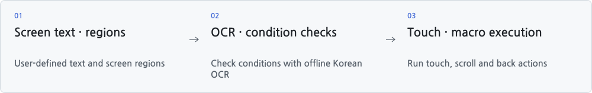

Additional operational checks: [75 actual OCR operations and five cycles of entry, 15 repetitions, and return (Korean source)](../실행점검/26차_연속운용/README.md) — two new device checks were added without changing the product APK.

<!-- readme-header32:start -->

<h1 align="center" id="project-title">PXE Project</h1>

An Android tool that reads screens and acts on conditions

  
  

  
  
  
  
  

<small>LEVEL links open the Korean source at the same reading level.</small>

<picture>
  <source media="(max-width: 600px) and (prefers-color-scheme: dark)" srcset="../assets/readme/flow-en-dark-mobile.svg" />
  <source media="(max-width: 600px)" srcset="../assets/readme/flow-en-light-mobile.svg" />
  <source media="(prefers-color-scheme: dark)" srcset="../assets/readme/flow-en-dark.svg" />
  <source media="(prefers-color-scheme: light)" srcset="../assets/readme/flow-en-light.svg" />
  
</picture>
<!-- readme-header32:end -->

An Android macro that checks user-defined text and regions to perform touches, scrolling, and back navigation.

Current app: revision 26 · 2.6.0 · Android 11 or later · ARM64 / x86_64 · offline Korean OCR

[User guide (Korean source)](../최종/사용안내.md) · [Revision 26 details (Korean source)](../docs/versions/26차.md#user-content-reading-level-1) · [Full source (Korean source)](../26차/source) · [Verification results (Korean source)](../26차/검증_결과.md)

## Choose a reading level

| Level | What to read |
| --- | --- |
| [LEVEL 1 - Beginner (Korean source)](../docs/읽기안내/레벨1.md) | An accessible guide from installation to running |
| [LEVEL 2 - Explorer (Korean source)](../docs/읽기안내/레벨2.md) | How detection and execution flow |
| [LEVEL 3 - Practitioner (Korean source)](../docs/읽기안내/레벨3.md) | Settings, saving, and building |
| [LEVEL 4 - Advanced (Korean source)](../docs/읽기안내/레벨4.md) | Implementation, errors, and cancellation |
| [LEVEL 5 - Expert (Korean source)](../docs/읽기안내/레벨5.md) | Code, execution evidence, and full comparisons |

## Revision 27 preparation build · speed and screen refinements

The existing macros and offline OCR are retained, with refinements to capture waiting, status indicators, and light/dark colors. **Revision 26 remains the default final release.** The revision 27 60-minute check is not marked complete because a host reboot left no evidence of its ending.

| Material | What was checked |
|---|---|
| [Revision 27 materials (Korean source)](../27차) · [User guide (Korean source)](../27차/사용안내.md) | The universal APK and full package are provided in the local revision 27 folder |
| [Revision 27 verification results (Korean source)](../27차/검증_결과.md) | 106 unit tests, device checks for affected behavior, and a separate speed comparison; the long-duration assessment is incomplete |
| [Revision 27 details (Korean source)](../docs/versions/27차.md#user-content-reading-level-1) · [Full comparison (Korean source)](../27차/전체변경_분할/안내.md) | Explanations at the same reading level, actual additions/modifications/deletions, and original values |

On the dedicated Android 12 device, OCR touch tests of 15 operations × 5 segments averaged 10.2 seconds → 9.1 seconds, an **11.2% decrease**. This does not represent the completion time of an entire game macro or accuracy in all environments.

## Revision 26 · lightweight recognition based on revision 16

| Feature | Current behavior |
| --- | --- |
| Text recognition | Offline Korean OCR and screen information; Unicode whitespace comparison and prevention of false matches for empty search terms |
| General macros | Recording, touch, gestures, waiting, conditional branches, back navigation, repetition, and saving |
| List detection | Up to 6 priorities, repetition counts, duplicate prevention, waiting after completion, and refresh |
| Execution controls | Ⅱ/▶, stop, move, collapse, opacity, and elapsed time |
| Screen | Retains revision 16 light/dark modes and the existing design |
| Slow window responses | Waits without accumulating queries and discards previous responses. Finite settings, stopping, and actual errors remain distinct |
| Separate AI features | Demonstration training, action models, and ONNX features are excluded. OCR is retained |

## Observed results

| Item | Revision 26 result |
| --- | --- |
| Unit tests and lint | **106 passed · 0 lint errors · 0 warnings** |
| Device checks of the final shrunk APK | **89 passed** · dedicated Android 12 virtual device |
| Installer | **32,717,854 bytes** · includes both ABIs · retains the existing signature |
| Size compared with the PC revision 16 build | **7.4% decrease** · does not indicate speed or recognition accuracy |

The actual user's BlueStacks, game, Note10+, and operation of 6 instances simultaneously were not operated or measured in this round. [Verification results (Korean source)](../26차/검증_결과.md) separate the evidence for each feature from the unverified scope. The APK and full package ZIP are provided in the local revision 26 and final folders; binaries are not uploaded to GitHub.

## Quick start

1. Install the universal APK as an update over the existing app and enable accessibility and display-over-other-apps permissions.
2. Follow the guide to define text, regions, and macros, then save them by name.
3. Set the macro to detect, repetitions, priority regions, return timing, and refresh timing.
4. After starting, control execution through Ⅱ/▶, stop, and progress/error logs.

[Previous revision 24 description (Korean source)](../docs/versions/24차.md) · [Revision documentation criteria (Korean source)](../docs/차수별_문서작성기준.md)

[Complete revision index (Korean source)](../docs/REVISION_INDEX.md)

## All revisions

Each revision description covers that revision's features, settings, and results. Comparisons with the preceding revision appear under **Changes and differences** in each document.

Expand all revisions and materials

| Revision | Main changes | Materials |
| --- | --- | --- |
| Base | The editing, service, and control sources in NEXSource2 and the partial wrappers in NEXSource3 differ in completeness. | [Material folder (Korean source)](../코드) · [Details at the same level (Korean source)](../docs/versions/기본.md#user-content-reading-level-5) · [Full comparison (Korean source)](../docs/revision-audit/기본.md) |
| 1 | Connects MainActivity editing, Store JSON saving, Step validation, and MacroService gestures. | [Material folder (Korean source)](../1차) · [Details at the same level (Korean source)](../docs/versions/1차.md#user-content-reading-level-5) · [Full comparison (Korean source)](../docs/revision-audit/1차.md) |
| 2 | Compares text actions, OCR preview JSON, usage instructions, and the verification records from that time. | [Material folder (Korean source)](../2차) · [Details at the same level (Korean source)](../docs/versions/2차.md#user-content-reading-level-5) · [Full comparison (Korean source)](../docs/revision-audit/2차.md) |
| 3 | Connects FloatingController and GesturePaths to separate controls, recording, curves, and multi-touch configuration. | [Material folder (Korean source)](../3차) · [Details at the same level (Korean source)](../docs/versions/3차.md#user-content-reading-level-5) · [Full comparison (Korean source)](../docs/revision-audit/3차.md) |
| 4 | Refresh, text detection, selected macros, and return form the Watch flow; regions and the notification icon also change. | [Material folder (Korean source)](../4차) · [Details at the same level (Korean source)](../docs/versions/4차.md#user-content-reading-level-5) · [Full comparison (Korean source)](../docs/revision-audit/4차.md) |
| 5 | The default 15 detection repetitions are not multiplied by the saved macro's full repetition count; WatchConfig is separated from the original. | [Material folder (Korean source)](../5차) · [Details at the same level (Korean source)](../docs/versions/5차.md#user-content-reading-level-5) · [Full comparison (Korean source)](../docs/revision-audit/5차.md) |
| 6 | Configures up to 6 non-overlapping priority regions, the target app, duplicate locking, and post-completion waiting, with temporary recording for preparation. | [Material folder (Korean source)](../6차) · [Details at the same level (Korean source)](../docs/versions/6차.md#user-content-reading-level-5) · [Full comparison (Korean source)](../docs/revision-audit/6차.md) |
| 7 | Prepared to run 5 Nox instances simultaneously, but did not start because the program could not be found and disk-space conditions were not met at that time. | [Material folder (Korean source)](../7차) · [Details at the same level (Korean source)](../docs/revision-audit/7차.md#user-content-reading-level-5) · [Full comparison (Korean source)](../docs/revision-audit/7차.md) |
| 8 | Connects QueryLane screen reading with the response paths in ReaderResponsivenessTest. | [Material folder (Korean source)](../8차) · [Details at the same level (Korean source)](../docs/versions/8차.md#user-content-reading-level-5) · [Full comparison (Korean source)](../docs/revision-audit/8차.md) |
| 9 | Floating playback does not start without settings; CapturePacer and CaptureRecoveryTest handle late captures and errors. | [Material folder (Korean source)](../9차) · [Details at the same level (Korean source)](../docs/versions/9차.md#user-content-reading-level-5) · [Full comparison (Korean source)](../docs/revision-audit/9차.md) |
| 10 | Distinguishes the MainActivity bottom navigation, card UI, and PXE name changes from the original behavior. | [Material folder (Korean source)](../10차) · [Details at the same level (Korean source)](../docs/versions/10차.md#user-content-reading-level-5) · [Full comparison (Korean source)](../docs/revision-audit/10차.md) |
| 11 | Covers the AUTO fallback to OCR when accessibility reading is slow, alongside pure regression, UTF-8, and device tools. | [Material folder (Korean source)](../11차) · [Details at the same level (Korean source)](../docs/versions/11차.md#user-content-reading-level-5) · [Full comparison (Korean source)](../docs/revision-audit/11차.md) |
| 12 | Distinguishes indefinite waiting for text touch/wait from the lifetime of responses arriving from a previous run or after a pause. | [Material folder (Korean source)](../12차) · [Details at the same level (Korean source)](../docs/versions/12차.md#user-content-reading-level-5) · [Full comparison (Korean source)](../docs/revision-audit/12차.md) |
| 13 | Manages stopping from a collapsed panel, disconnection, at most 2 unfinished captures, and one actual OCR Task. | [Material folder (Korean source)](../13차) · [Details at the same level (Korean source)](../docs/versions/13차.md#user-content-reading-level-5) · [Full comparison (Korean source)](../docs/revision-audit/13차.md) |
| 14 | Changes the teal UI, 48dp targets, motion settings, and the return to the original waitForever behavior when TEXT_TAP text disappears. | [Material folder (Korean source)](../14차) · [Details at the same level (Korean source)](../docs/versions/14차.md#user-content-reading-level-5) · [Full comparison (Korean source)](../docs/revision-audit/14차.md) |
| 15 | Indefinite waiting, skipping extra post-recognition waiting, and immediate list entry have different scopes. Immediate entry is off by default. | [Material folder (Korean source)](../15차) · [Details at the same level (Korean source)](../docs/versions/15차.md#user-content-reading-level-5) · [Full comparison (Korean source)](../docs/revision-audit/15차.md) |
| 16 | The default-off adaptiveWait applies only to adjacent conditions using the same recognition method and region, when the next text was confirmed absent beforehand. | [Material folder (Korean source)](../16차) · [Details at the same level (Korean source)](../docs/versions/16차.md#user-content-reading-level-5) · [Full comparison (Korean source)](../docs/revision-audit/16차.md) |
| 17 | Retains a single query, rechecking a fresh screen, retrying completed OCR, and 0.25–2 second intervals, while distinguishing actual disconnection. | [Material folder (Korean source)](../17차) · [Details at the same level (Korean source)](../docs/versions/17차.md#user-content-reading-level-5) · [Full comparison (Korean source)](../docs/revision-audit/17차.md) |
| 18 | Increments the count only after actual completion, separates 7/15 completed from the 8th run in progress, and displays stage and status text in addition to color. | [Material folder (Korean source)](../18차) · [Details at the same level (Korean source)](../docs/versions/18차.md#user-content-reading-level-5) · [Full comparison (Korean source)](../docs/revision-audit/18차.md) |
| 19 | Prevents stale coordinates, unnecessary back navigation, and duplicate releases; rechecks the target app while retaining previous completion counts. | [Material folder (Korean source)](../19차) · [Details at the same level (Korean source)](../docs/versions/19차.md#user-content-reading-level-5) · [Full comparison (Korean source)](../docs/revision-audit/19차.md) |
| Execution check 2 | Checks PNG CRC, width, height, SHA, and command records for the preserved capture tool. | [Material folder (Korean source)](../실행점검/2차) · [Details at the same level (Korean source)](../docs/versions/실행점검-2차.md#user-content-reading-level-5) · [Full comparison (Korean source)](../docs/revision-audit/실행점검-2차.md) |
| `최종.json` | Reads macro data containing text, coordinates, retries, waiting, and scrolling conditions. | [Material folder (Korean source)](../docs/materials/022-최종설정) · [Original file (Korean source)](../최종.json) · [Details at the same level (Korean source)](../docs/materials/022-최종설정/README.md#user-content-reading-level-5) · [Full comparison (Korean source)](../docs/versions/최종설정.md) |
| Unique working materials | Distinguishes ZIP path, link, encryption, and size checks from identical-byte or BOM/newline correspondence, preserving unique sources. | [Material folder (Korean source)](../보존자료/작업소스) · [Details at the same level (Korean source)](../docs/SOURCE_MATERIALS.md#user-content-reading-level-5) · [Full comparison (Korean source)](../docs/REVISION_AUDIT.md) |
| 20 · test tools | Observes OCR, 15 repetitions, absence and reappearance, and duplicate blocking, comparing host/device times and generations. | [Material folder (Korean source)](../20차) · [Details at the same level (Korean source)](../docs/versions/20차.md#user-content-reading-level-5) · [Full comparison (Korean source)](../docs/revision-audit/20차.md) |
| 21 | Connects absence of the checked text, priority for return text, restarting from the beginning for new text, and blocking late responses from an old generation. | [Material folder (Korean source)](../21차) · [Details at the same level (Korean source)](../docs/versions/21차.md#user-content-reading-level-5) · [Full comparison (Korean source)](../docs/revision-audit/21차.md) |
| 22 | Improves movement/collapse of the small progress window and waiting flows, separating public source from operational materials. | [Material folder (Korean source)](../22차) · [Details at the same level (Korean source)](../docs/versions/22차.md#user-content-reading-level-5) · [Full comparison (Korean source)](../docs/revision-audit/22차.md) |
| 23 | Binds the F64 MLP with OCR 584 → 32 → K, 2 demonstrations, 192 training steps, 1 automatic touch, 0 inputs after ending, and 64 after import to the version. | [Material folder (Korean source)](../23차) · [Details at the same level (Korean source)](../docs/versions/23차.md#user-content-reading-level-5) · [Full comparison (Korean source)](../docs/revision-audit/23차.md) |
| 24 | Distinguishes the 1160-dimensional OCR + RGB policy, legacy 584 compatibility, waiting on the same future, control-window repairs, and the 280 passing unit tests in 44 classes from successful build 13. | [Material folder (Korean source)](../24차) · [Details at the same level (Korean source)](../docs/versions/24차.md#user-content-reading-level-5) · [Full comparison (Korean source)](../docs/revision-audit/24차.md) |
| 27 · preparation build | Capture waiting, status indicators, and color refinements; long-duration assessment incomplete. | [Material folder (Korean source)](../27차) · [Details at the same level (Korean source)](../docs/versions/27차.md#user-content-reading-level-1) · [Full comparison (Korean source)](../docs/revision-audit/27차.md) |
| 26 | Uses revision 16 basic macros and UI as its baseline, excludes separate AI, and improves text comparison, window responses, and shrinking. | [Material folder (Korean source)](../26차) · [Details at the same level (Korean source)](../docs/versions/26차.md#user-content-reading-level-5) · [Full comparison (Korean source)](../docs/revision-audit/26차.md) |
| Final | Revision 26 universal APK, full source package ZIP, and user guide. | [Material folder (Korean source)](../최종) · [Details at the same level (Korean source)](../최종/README.md#user-content-reading-level-5) · [Full comparison (Korean source)](../docs/revision-audit/최종.md) |

