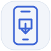
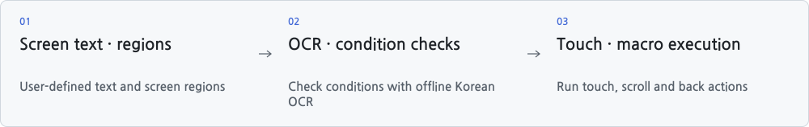

<!-- readme-header32:start -->

<h1 align="center" id="project-title">PXE Project</h1>

An Android tool that reads screens and acts on conditions

  
  

  
  
  
  
  

<small>LEVEL links open the English explanation at the selected reading level.</small>

<picture>
  <source media="(max-width: 600px) and (prefers-color-scheme: dark)" srcset="../assets/readme/flow-en-dark-mobile.svg" />
  <source media="(max-width: 600px)" srcset="../assets/readme/flow-en-light-mobile.svg" />
  <source media="(prefers-color-scheme: dark)" srcset="../assets/readme/flow-en-dark.svg" />
  <source media="(prefers-color-scheme: light)" srcset="../assets/readme/flow-en-light.svg" />
  
</picture>
<!-- readme-header32:end -->

An Android tool that checks text and regions, then runs touches, gestures, waits and back navigation.

**Latest revision: 28 · 2.8.5 · Android 11+ · ARM64 / x86_64 · offline Korean OCR.** The existing default final revision 26 is preserved. Revision 28 adds the independently checked word/phrase recovery; it is not a new long-duration or game-speed certification.

| Reading level | Start in English |
|---|---|
| LEVEL 1 - Beginner | [Recognize text and use the controls](docs/round28.md#user-content-reading-level-1) |
| LEVEL 2 - Explorer | [Follow recognition and execution](docs/round28.md#user-content-reading-level-2) |
| LEVEL 3 - Practitioner | [Install, configure and build](docs/round28.md#user-content-reading-level-3) |
| LEVEL 4 - Advanced | [Inspect matching, state and cancellation](docs/round28.md#user-content-reading-level-4) |
| LEVEL 5 - Expert | [Read regression evidence and limits](docs/round28.md#user-content-reading-level-5) |

## Revision 28 · Word and Phrase Recovery

The OCR path previously compared only a complete line, so `Adobe` could be missed in `Adobe 15`. Version 2.8.5 restores candidates for exact independent words and multi-element phrases. It still rejects the `Adobe` substring of `AdobePro` or `Adobe15`, and does not translate `어도비` or ignore the case difference in `ADOBE`.

| Material | What it establishes | Limit |
|---|---|---|
| [Revision 28 English](docs/round28.md) | Matching rules, controls, settings, implementation and five reading levels | OCR can still misread text |
| [Korean verification record](../28차/검증_결과.md) | 112 unit tests, lint 0, four actual MLKit candidate methods and two recognition/touch methods | Controlled device evidence, not a game accuracy or speed result |
| [Package fingerprints](../28차/파일정보.json) | Local APK and ZIP sizes, SHA-256 and existing signing certificate | APK/ZIP delivery remains local; no new GitHub release assets |
| [Revision 28 source](../28차/source/) | Actual Android and PC build-time Rust sources | Build dependencies and signing material are separate |

## Quick Start

1. Export important macros, then install the local universal APK as an update using the existing package/signature.
2. Enable accessibility and display-over-other-apps permissions; follow the app's screen-capture permission flow for OCR.
3. Set the target text, up to six priority regions, macro, repetitions and timing.
4. Check the actual screen in preview before starting. Change text from the lower arrow panel or a saved shortcut.
5. Use the app or upper control window to pause, resume or stop. The lower progress widget has no pause/stop buttons.

Cancelling text editing preserves the current settings and execution. Opening the app may pause execution; resume continues the existing task, while starting a new target replaces the applicable execution generation.

## Revisions and Evidence

| Revision | Read | Interpretation |
|---|---|---|
| 26 · existing default final | [Original English overview and full history](README-revision26.md) · [Korean details](../docs/versions/26차.md) | Historical 106 unit tests and 89 device checks belong to revision 26 |
| 27 · preparation build | [Korean details](../docs/versions/27차.md) · [Verification](../27차/검증_결과.md) | Earlier 15-operation × five-segment timing is not a 2.8.5 speed result; the 60-minute ending was not established |
| 28 · latest 2.8.5 | [English, five levels](docs/round28.md) · [Korean details](../28차/상세설명.md) · [Full comparison](../28차/전체변경_분할/변경_1.md) | Word/phrase regression recovery; existing UI and macro control preserved |

[Complete revision index · Korean](../docs/REVISION_INDEX.md) · [Korean project overview](../README.md) · [Current user guide · Korean](../28차/사용안내.md)

The latest tests used a dedicated Android 12/API31 x86_64 AVD and isolated ADB port 5047. User BlueStacks, games and the default ADB server were not operated. Long-running stability, the user's 15-repeat game completion time and a 99% recognition rate remain unverified.
